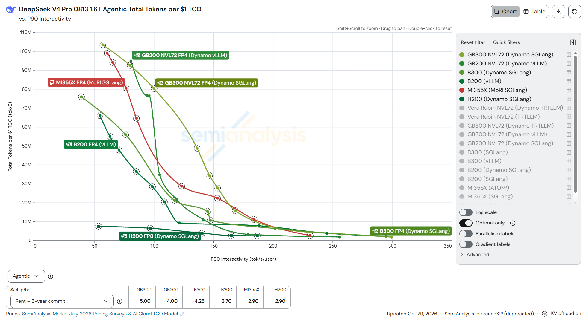
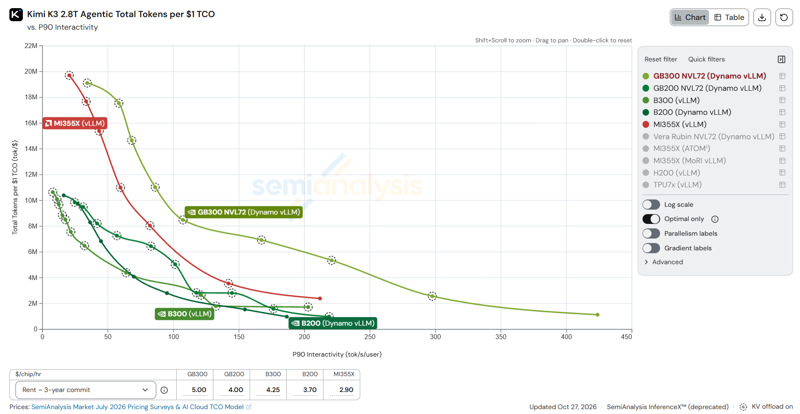
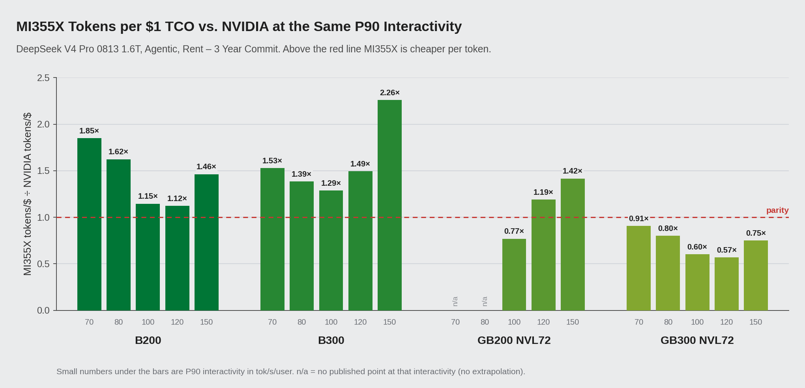
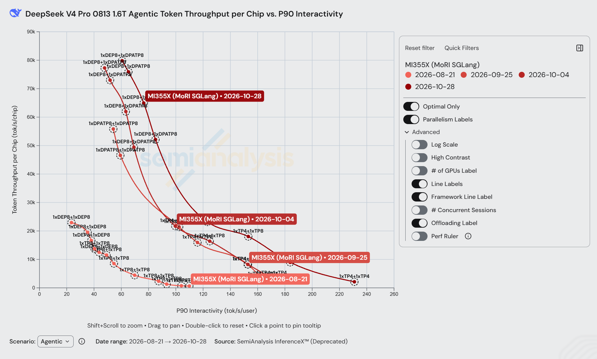
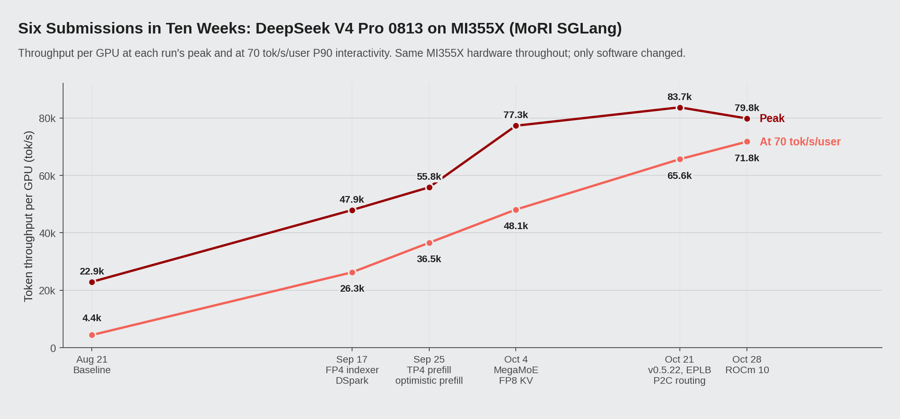
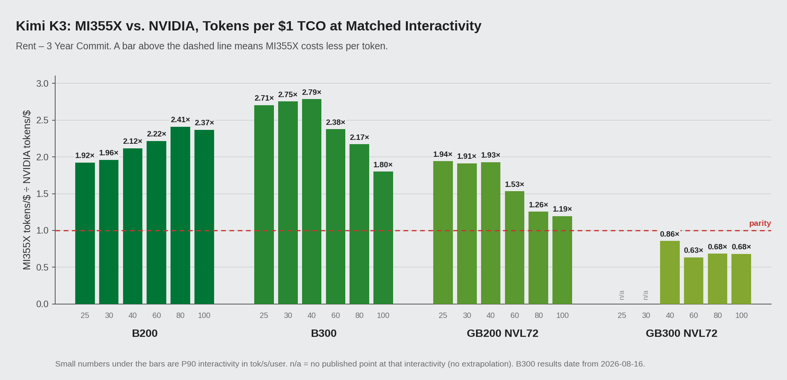
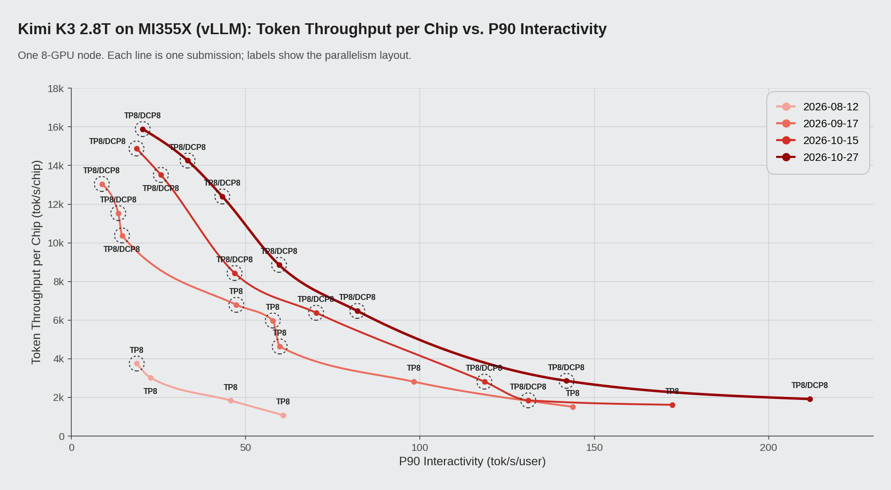
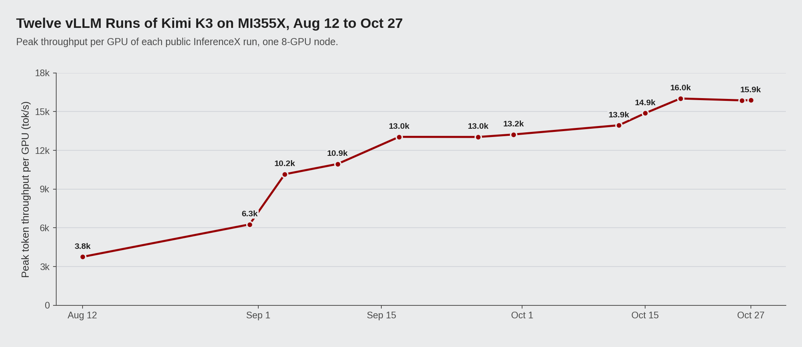

# AMD Instinct™ MI355X 跑智能体推理：DeepSeek-V4-Pro 和 Kimi-K3 每美元 token 产出最高达 B200 的 2.4 倍

*2026 年 11 月*

从 8 月开始，我们在 SemiAnalysis 公开的 AgentX 基准上，用 AMD Instinct MI355X 跑两个大型 MoE 模型：用 SGLang 加 MoRI 跑 DeepSeek-V4-Pro（1.6T），用 vLLM 跑 Kimi-K3（2.8T）。两个模型上，在和 B200、B300 重叠的交互速度范围里，MI355X 的每美元 token 产出几乎处处更高，唯一的例外是 DeepSeek-V4-Pro 在单用户那一端（约 220 tok/s/用户以上）。在下文的对比中，DeepSeek-V4-Pro 上最多是 B200 的 1.85 倍、B300 的 2.26 倍。Kimi-K3 上是 B200 的 1.9–2.4 倍、B300 的 1.8–2.8 倍，对 GB200 NVL72 也领先 1.2–1.9 倍，每美元 token 数峰值在 dashboard 上最高。

*图 1：DeepSeek-V4-Pro FP4 AgentX，「每 1 美元 TCO 总 token 数」vs.「P90 交互速度」，Rent – 3 年承诺档位，[InferenceX dashboard](https://inferencex.semianalysis.com/inference/deepseek-v4) 截图（数据更新于 2026-10-29）。每个系统只显示一个框架：GB300 NVL72 和 B300 为 Dynamo SGLang，GB200 NVL72 为 Dynamo vLLM，B200 为 vLLM，H200 为 Dynamo SGLang，MI355X 为 MoRI SGLang（红色）。MI355X 的 KV offload 用的是 MoRI UMBP。表 2 对每个 NVIDIA 系统取最好的框架，所以表中 B300 和 GB300 的峰值（分别是 SGLang 的 8270 万和 Dynamo vLLM 的 1.128 亿）比图中曲线更高。*

*图 2：Kimi-K3 FP4 AgentX，「每 1 美元 TCO 总 token 数」vs.「P90 交互速度」，Rent – 3 年承诺档位，[InferenceX dashboard](https://inferencex.semianalysis.com/inference/kimi-k3) 截图（更新于 2026-10-27）。每个系统只显示一个框架：GB300 NVL72、GB200 NVL72 和 B200 为 Dynamo vLLM，B300 和 MI355X 为 vLLM。虚线圈表示该点开启了 KV offload。*

领先的大部分来自软件：硬件没换，8 月到 10 月，DeepSeek-V4-Pro 的单卡吞吐峰值提升了 3.5 倍，Kimi-K3 提升了 4.2 倍。

下面先介绍这个基准和 MI355X 的硬件，然后逐个模型来看：MI355X 和 NVIDIA 的 GPU 比起来怎么样，8 月以来结果是怎么提升的，以及是哪些改动带来了提升。

## 负载与硬件

AgentX 是 SemiAnalysis 用真实的 agentic 编程会话做成的基准，在公开的 InferenceX CI 上运行。它回放完整的会话：每一轮把工具输出拼到上下文后面，再整个发给模型。一个会话约 43 轮，单轮输入中位数 142K token、输出 444 token，超过 96% 的 prompt token 是服务端已经处理过的前缀。这个基准的更多细节见我们的[上一篇文章](https://www.amd.com/en/developer/resources/technical-articles/2026/mori-umbp-empowers-amd-instinct-gpus.html)。

从硬件角度看，最关键的是这些一轮轮回来的长上下文：它们让大量模型状态和 KV cache 同时驻留，所以先要看的硬件指标是显存容量。在这里比较的几个系统中，MI355X 的单卡 HBM 最大（表 1）。

*表 1：单卡规格（取自 InferenceX GPU 规格页），以及计算 TCO 用的 Rent – 3 年承诺价格。*

| | MI355X | B200 | B300 | GB200 NVL72 | GB300 NVL72 |
|---|---|---|---|---|---|
| HBM 容量 | 288 GB HBM3E | 180 GB | 268 GB | 186 GB | 278 GB |
| HBM 带宽 | 8 TB/s | 8 TB/s | 8 TB/s | 8 TB/s | 8 TB/s |
| 稠密 FP4 算力 | 10.1 PFLOPS | 9.0 PFLOPS | 13.5 PFLOPS | 10.0 PFLOPS | 15.0 PFLOPS |
| Rent 价格（$/GPU/小时） | $2.90 | $3.70 | $4.25 | $4.00 | $5.00 |

两个模型的部署选择，大多就是由这块显存决定的。FP4 的 DeepSeek-V4-Pro 放进四张 MI355X 还能剩下空间给 KV cache，所以配方在并发 16–48 用 TP4 prefill，在并发 1 用 TP4 + TP4；而 B200 已公开的 AgentX 配方，每个角色都是八张卡。Kimi-K3 的 MXFP4 权重约 1.56 TB，TP8 下每张 MI355X 约 195 GB，整个模型一台 8 卡节点就能跑。八张 B200（1.44 TB）或八张 GB200（1.49 TB）连权重都放不下，两者已公开的配置都把模型拆到两台节点上，用流水线并行来跑。

算力是另一回事。B300 的稠密 FP4 比 MI355X 高约三分之一，但在 DeepSeek-V4-Pro 70 tok/s/用户下，MI355X 单卡跑到 71.8k tok/s，B300 是 68.8k。Kimi-K3 在 40 tok/s/用户下，MI355X 的单卡吞吐是 B200 的 1.66 倍，而 FP4 算力只高 12%。下面的大部分工作，就是在缩小两个模型实际跑出来的性能和硬件能力之间的差距。

## DeepSeek-V4-Pro：SGLang 加 MoRI UMBP

DeepSeek-V4-Pro 上，这部分工作很大一块落在 KV cache 上。这个模型用 SGLang 跑，MoRI 负责 prefill/decode 分离和 MoE all-to-all，8 卡节点之间走标准 RoCE。前缀复用超过 96%，服务成本就取决于能不能把以前算好的 KV cache 留在手边，而不是重算。MoRI UMBP（Unified Memory & Bandwidth Pool）是 AMD MoRI 团队为此做的 KV cache 层。通过我们和 SGLang 社区一起设计的 KVCache Store Linker，SGLang 的 radix tree 直接连到一个 DRAM 池。这个池在 DP rank 和模型实例之间共享，原本每个 TP rank 都要存一份的 KV 只存一份，而且运行在引擎进程之外，引擎重启后缓存还在。同一配方下打开 MoRI UMBP，并发 256 的单卡吞吐提升 8.3%，P90 TTFT 降低 35%。从 9 月 25 日起，MI355X 的每个点（并发 1 到 512）都用它。它的设计和测量细节见[上一篇文章](https://www.amd.com/en/developer/resources/technical-articles/2026/mori-umbp-empowers-amd-instinct-gpus.html)。

### 与 NVIDIA 对比

所有点都由 MoRI UMBP 服务之后，MI355X 的曲线相对 NVIDIA 各系统处在什么位置，见表 2、图 3 和文章开头的图 1。

*表 2：DeepSeek-V4-Pro，每 1 美元 TCO 总 token 数（百万，Rent 档位）。「—」表示该系统在这个交互速度没有公开数据点；括号内是 MI355X 与该系统之比。NVIDIA 各系统取所有已公开框架里的最好点。*

| P90 交互速度 | MI355X | B200 | B300 | GB200 NVL72 | GB300 NVL72 |
|---|---|---|---|---|---|
| 70 tok/s/用户 | 89.1 | 48.1 (1.85×) | 58.3 (1.53×) | — | 98.1 (0.91×) |
| 80 tok/s/用户 | 74.3 | 45.8 (1.62×) | 53.6 (1.39×) | — | 92.5 (0.80×) |
| 100 tok/s/用户 | 44.8 | 39.1 (1.15×) | 34.8 (1.29×) | 58.2 (0.77×) | 74.1 (0.60×) |
| 120 tok/s/用户 | 30.2 | 26.9 (1.12×) | 20.2 (1.49×) | 25.3 (1.19×) | 53.0 (0.57×) |
| 150 tok/s/用户 | 23.2 | 15.9 (1.46×) | 10.3 (2.26×) | 16.4 (1.42×) | 30.9 (0.75×) |
| 峰值 | 99.1 | 66.1 (1.50×) | 82.7 (1.20×) | 95.0 (1.04×) | 112.8 (0.88×) |

*图 3：DeepSeek-V4-Pro，相同 P90 交互速度下 MI355X 与各 NVIDIA 系统每美元 token 数之比（Rent 档位）。*

表 2 中每个档位 MI355X 都比 B200 和 B300 强，每美元 token 产出是 B200 的 1.12–1.85 倍、B300 的 1.29–2.26 倍。只看单卡吞吐，在这个范围内 MI355X 最多落后其中任何一个 12%，在 70 和 150 tok/s/用户时比两者都高；剩下的差距来自价格更低。换成 Owning 成本档位，70 tok/s/用户时 MI355X 仍然是 B200 的 1.67 倍、B300 的 1.57 倍。

和 72 卡的 NVLink 整机柜比，则互有胜负。MI355X 峰值略高于 GB200 NVL72（9910 万对 9500 万），120–150 tok/s/用户也更好，GB200 则在 100 tok/s/用户附近领先。GB300 NVL72 在每个档位都领先，我们最接近的时候是 65 tok/s/用户，达到它每美元 token 数的 0.95 倍。

### 十周里曲线是怎么变化的

8 月时情况还不是这样，扭转它用了十周的软件工作。8 月 21 日，我们在 MI355X 上跑了这个模型的第一份完整 AgentX，单卡吞吐峰值 22.9k tokens/s；到 10 月 28 日，同样的硬件峰值是 79.8k，提升 3.5 倍，每 1 美元 TCO 的 token 数峰值也从 2850 万升到 9910 万。在 70 tok/s/用户下提升更大，单卡从 4.4k 涨到 71.8k tokens/s，是 16 倍。图 4 是曲线的变化过程，图 5 跟踪了每一次提交。

*图 4：MI355X MoRI-SGLang AgentX 配方的单卡吞吐 vs. P90 交互速度，[InferenceX dashboard](https://inferencex.semianalysis.com/inference/deepseek-v4) 截图，包含以下几次运行：[8 月 21 日](https://github.com/SemiAnalysisAI/InferenceX/actions/runs/32269076444/attempts/4)、[9 月 25 日](https://github.com/SemiAnalysisAI/InferenceX/actions/runs/35879254139/attempts/1)、[10 月 4 日](https://github.com/SemiAnalysisAI/InferenceX/actions/runs/37181045340/attempts/1)、[10 月 28 日](https://github.com/SemiAnalysisAI/InferenceX/actions/runs/40473082761/attempts/4)。虚线圈表示开启了 KV offload，9 月 25 日起用的是 MoRI UMBP。*

*图 5：DeepSeek-V4-Pro 六次提交各自的单卡吞吐峰值，以及 70 tok/s/用户下的单卡吞吐。*

这十周里一共六次提交，9 月中旬以后基本一到两周就有一次。每一次都提高了 70 tok/s/用户下的吞吐，9 月 17 日以后每次多 9–39%；峰值涨得最多的是 9 月 17 日（2.1 倍）和 10 月 4 日（1.4 倍）。后面几次运行对单用户速度的帮助比对峰值大：从 10 月 4 日到 10 月 28 日，并发 192 的吞吐只涨了 5%，P90 交互速度却从 69.3 升到了 85.1 tok/s/用户。有些提升还是在少用卡的情况下拿到的：并发 16–48 的配方现在用 12 张卡，而不是 16 张。

### 关键优化

这些优化覆盖了 kernel、显存、调度和平台等方面。表 3 列出了具体改动，大致按实测提升从大到小排列，都在公开的 SGLang ROCm 镜像（`lmsysorg/sglang-rocm`）和 [InferenceX 配方](https://github.com/SemiAnalysisAI/InferenceX)里。

*表 3：DeepSeek-V4-Pro 的主要优化及实测效果，吞吐均为单卡。并发 192 的数字来自 [InferenceX PR #2823](https://github.com/SemiAnalysisAI/InferenceX/pull/2823) 的中间 CI 测试，每一步都是同样的 16 张卡。*

| 优化 | 做了什么 | 所在组件 | 实测效果 |
|---|---|---|---|
| FP4 稀疏注意力 indexer、DP attention 加 EP1 | DeepSeek-V4 的 DSA indexer 改跑 gfx950 上的 AITER FP4 kernel，它的 KV 从每 token 132 B 降到 68 B | AITER、SGLang | 并发 192 吞吐 +51%；P90 TTFT 33.6 s → 20.5 s |
| MegaMoEv2 prefill、并发 192–512 用 FP8 KV | 用一个 FlyDSL kernel 融合 MoE 的 dispatch、专家 GEMM 和 combine，做 8 路专家并行（[sglang#35619](https://github.com/sgl-project/sglang/pull/35619)）；KV 池的 NoPE 部分改存 FP8 | AITER（FlyDSL）、SGLang | 并发 256 吞吐 +11%；并发 384–512 可用，峰值 55.8k → 77.3k |
| SGLang v0.5.22：并发 1–48 用 FP8 KV、EPLB、power-of-two decode 路由 | FP8 KV 扩展到低并发；MegaMoE prefill 做专家负载均衡；decode 负载在各 DP rank 之间分得更匀 | SGLang、AITER | 70 tok/s/用户下吞吐 48.1k → 65.6k（+36%） |
| MoRI UMBP linker、TP4 prefill | MoRI UMBP 把 KV 放到 DRAM，并发 16–48 的 prefill 从 TP8 降到 TP4，12 卡代替 16 卡 | MoRI、SGLang | 并发 16–48 吞吐 +26–34%，卡数少 25% |
| 乐观 prefill、去掉 host 同步 | 不等 decode 完成 bootstrap 就开始 prefill，投机 KV 归请求自己持有；去掉 DSpark prefill 里的一次 host 同步 | SGLang | 并发 256 的 P90 TTFT −27.7%，并发 128–256 再降 13–16% |
| ROCm 10 | 镜像换成 ROCm 10；并发 512 的峰值从 83.7k 略降到 79.8k，换来更高的交互速度 | ROCm | 并发 192–512 的 P90 交互速度 +6–17%；70 tok/s/用户下吞吐 +9% |

## Kimi-K3：vLLM

MI355X 的显存优势，在 Kimi-K3 上体现得最明显。这个模型有 2.8T 参数、896 个专家，原生上下文 1M token。一部分层用 Kimi Delta Attention（KDA），每个请求带一份循环状态；其余层用 MLA 和分页 KV cache。模型还附带一个 DSpark draft head（Inferact/Kimi-K3-DSpark）用于投机解码。这种组合对智能体流量不太友好：会话回来时，KV 页和 KDA 状态都得找回来，否则就要重算前缀，而 AgentX 上几乎每个请求都是回来的会话。我们用 vLLM 在一台 8 卡 MI355X 节点上跑它；前面讲过，B200 和 GB200 做不到这一点。

### 与 NVIDIA 对比

表 4、图 6 和文章开头的图 2 把这台单节点的 MI355X 和 NVIDIA 各系统放在一起比较。

*表 4：Kimi-K3，固定 P90 交互速度下每 1 美元 TCO 的 token 数（百万，Rent 档位）。括号里是 MI355X 与该系统之比；「—」表示该系统在这一档附近没有数据。NVIDIA 各系统取已公开框架里最好的结果。*

| P90 交互速度 | MI355X | B200 | B300¹ | GB200 NVL72 | GB300 NVL72 |
|---|---|---|---|---|---|
| 25 tok/s/用户 | 19.1 | 9.9 (1.92×) | 7.1 (2.71×) | 9.8 (1.94×) | — |
| 40 tok/s/用户 | 16.2 | 7.7 (2.12×) | 5.8 (2.79×) | 8.4 (1.93×) | 18.9 (0.86×) |
| 60 tok/s/用户 | 10.9 | 4.9 (2.22×) | 4.6 (2.38×) | 7.1 (1.53×) | 17.2 (0.63×) |
| 80 tok/s/用户 | 8.3 | 3.4 (2.41×) | 3.8 (2.17×) | 6.6 (1.26×) | 12.1 (0.68×) |
| 100 tok/s/用户 | 6.2 | 2.6 (2.37×) | 3.4 (1.80×) | 5.2 (1.19×) | 9.1 (0.68×) |
| 峰值 | 19.7 | 10.4 (1.89×) | 10.6 (1.86×) | 9.9 (1.99×) | 19.1 (1.03×) |

¹ B300 最新公开的 Kimi-K3 结果是 2026-08-16 的，其余都是 10 月测的。

*图 6：Kimi-K3，相同 P90 交互速度下 MI355X 每美元 token 数除以各 NVIDIA 系统的（Rent 档位）。柱子高过 1.0，说明 MI355X 每 token 更便宜。*

在表 4 的每一档，B200、B300 和 GB200 NVL72 都落后于 MI355X，差距分别是 1.9–2.4 倍、1.8–2.8 倍和 1.2–1.9 倍。这里和 B200 的差距主要来自吞吐，而不是价格：在这个范围内，一张 MI355X 干的活是一张 B200 的 1.5–1.9 倍，40 tok/s/用户时是 13.1k 对 7.9k tokens/s。和 GB200 比，在 25–40 tok/s/用户大约是 1.4 倍。换成 Owning 档位的价格，领先幅度略有收窄，对 B200 是 1.7–2.2 倍，对 GB200 是 1.1–1.7 倍。

GB300 NVL72 又是例外。从 40 tok/s/用户往上，它的每美元 token 数更高，MI355X 只有它的 0.63–0.86 倍；GB300 这些点用的是 NVLink 机柜内 24 到 40 卡的宽 EP 分离式部署。在低交互速度那一端，MI355X 的峰值是 20.5 tok/s/用户时的 1970 万，略高于 GB300 的 1910 万。

### 同样八张卡，吞吐提升 4.2 倍

和 DeepSeek-V4-Pro 一样，这个领先也是最近才有的。8 月 12 日，vLLM 在 MI355X 上提交了第一份 Kimi-K3 AgentX，比 NVIDIA 的第一份结果晚两周，单卡峰值 3.8k tokens/s。到 10 月 27 日，峰值是 15.9k。中等交互速度下变化更大：40 tok/s/用户时，单卡吞吐从 2.1k 涨到 13.1k tokens/s；单用户速度从 61 升到 212 tok/s/用户。图 7 画了十二次运行中的四次，图 8 是每一次的峰值。

*图 7：Kimi-K3 其中四次 vLLM 运行的单卡吞吐随 P90 交互速度的变化。标签是并行布局（TP8，或 TP8 加 8 路 decode 上下文并行）；有虚线圈的点用了 DRAM KV 层。*

*图 8：Kimi-K3 全部十二次 vLLM 运行的单卡吞吐峰值。*

峰值的提升大多发生在前期。头三周里，decode 上下文并行和 DRAM KV 层让并发 44–52 能实际跑起来，峰值从 3.8k 升到 10.2k。之后的运行对峰值影响不大，但一直在抬高曲线中段，40 tok/s/用户下每次最多再涨 19%。

### 关键优化

这段提升背后的 vLLM 改动列在表 5，按实测效果排序。它们都在公开的 `vllm/vllm-openai-rocm` nightly 镜像里，也都接进了 InferenceX 配方。

*表 5：MI355X 上 Kimi-K3 的 vLLM 改动按效果排序，吞吐为单卡。某个 tok/s/用户下的数值，从对应运行的曲线上读出。*

| 改动 | 做了什么 | 涉及组件 | 效果 |
|---|---|---|---|
| DCP8 和 DRAM KV 层 | decode 的 KV 读取分到全部 8 张卡上；HBM 放不下的 KV 页放到每 rank 约 225 GB 的 DRAM，并发 60 以内都能在一台节点上跑 | vLLM、AITER | 40 tok/s/用户下 2.1k → 6.9k；峰值 3.8k → 10.2k |
| DSpark draft 改用 AITER MLA | draft 模型的注意力从 Triton MLA 换成 AITER MLA（[vllm#55966](https://github.com/vllm-project/vllm/pull/55966)） | vLLM、AITER | 并发 1 的 P90 交互速度 +28.9%，吞吐 +14.5% |
| 几乎所有点都用 DCP8，AITER ASM verify | 几乎每个并发都用 DCP8；投机解码的多 token verify 跑在 AITER ASM kernel 上 | vLLM、AITER | 20 tok/s/用户下 +26% |
| AITER Gluon KDA kernel、低延迟 MoE router GEMM | KDA 的 decode 和投机解码用 Gluon kernel（[vllm#57392](https://github.com/vllm-project/vllm/pull/57392)）；router GEMM 支持任意输入 shape（[vllm#61895](https://github.com/vllm-project/vllm/pull/61895)） | vLLM、AITER | 40 tok/s/用户下 +19%；峰值 14.9k → 16.0k |
| 并发 1 使用常驻 FlyDSL decode kernel | 每个 MoE decoder 层跑成一个常驻 kernel，TP all-reduce 在 kernel 内完成（[vllm#60683](https://github.com/vllm-project/vllm/pull/60683)） | vLLM、FlyDSL | 单用户速度 178 → 211 tok/s/用户 |
| FP8 融合、latent-MoE 只存本 rank 分片 | AttnRes 输出与逐 token FP8 量化融合（[vllm#59069](https://github.com/vllm-project/vllm/pull/59069)）；latent-MoE up-projection 只存本 rank 分片（[vllm#59591](https://github.com/vllm-project/vllm/pull/59591)） | vLLM | 30 tok/s/用户下 +17%；峰值 13.9k → 14.9k |
| 兼顾尾部延迟的准入上限 | 最慢的 10% decode step 都出现在最大的批次里，于是把并发 4–32 的运行序列数上限压到这个规模以下 | vLLM | 40 tok/s/用户下 +15%，60 tok/s/用户下 +17% |

## 致谢

感谢 SGLang 和 vLLM 社区的设计评审和快速合入，感谢 Moonshot AI，感谢 Inferact 提供 DSpark draft 模型，感谢 SemiAnalysis 提供 AgentX 和 InferenceX CI 基础设施，也感谢 AMD MoRI、SGLang、AITER、vLLM 和 ROCm 团队。

## 参考资料

1. SemiAnalysis InferenceX，DeepSeek-V4 dashboard。https://inferencex.semianalysis.com/inference/deepseek-v4
2. SemiAnalysis InferenceX，Kimi-K3 dashboard。https://inferencex.semianalysis.com/inference/kimi-k3
3. SemiAnalysis AI Cloud TCO Model（$/GPU/hr 价格来源）。https://semianalysis.com/ai-cloud-tco-model/
4. AMD，*MoRI UMBP Empowers AMD Instinct™ MI355X GPU to Demonstrate Token-per-Dollar TCO Leadership on the Public AgentX Leaderboard*。https://www.amd.com/en/developer/resources/technical-articles/2026/mori-umbp-empowers-amd-instinct-gpus.html
5. AMD，*Rebuilding Agentic AI from First Principles for AMD GPU*，与 Moonshot AI 联合发布。https://www.amd.com/en/developer/resources/technical-articles/2026/rebuilding-agentic-ai-for-amd-gpu.html
6. MI355X 上 DeepSeek-V4-Pro 的 InferenceX 配方演进：PR [#2823](https://github.com/SemiAnalysisAI/InferenceX/pull/2823)、[#3188](https://github.com/SemiAnalysisAI/InferenceX/pull/3188)、[#3256](https://github.com/SemiAnalysisAI/InferenceX/pull/3256)、[#3664](https://github.com/SemiAnalysisAI/InferenceX/pull/3664)、[#4186](https://github.com/SemiAnalysisAI/InferenceX/pull/4186)、[#4571](https://github.com/SemiAnalysisAI/InferenceX/pull/4571)。
7. MI355X 上 Kimi-K3 vLLM 配方的 InferenceX 演进：PR [#2508](https://github.com/SemiAnalysisAI/InferenceX/pull/2508)、[#2787](https://github.com/SemiAnalysisAI/InferenceX/pull/2787)、[#2810](https://github.com/SemiAnalysisAI/InferenceX/pull/2810)、[#3124](https://github.com/SemiAnalysisAI/InferenceX/pull/3124)、[#3833](https://github.com/SemiAnalysisAI/InferenceX/pull/3833)、[#3951](https://github.com/SemiAnalysisAI/InferenceX/pull/3951)、[#4215](https://github.com/SemiAnalysisAI/InferenceX/pull/4215)、[#4393](https://github.com/SemiAnalysisAI/InferenceX/pull/4393)、[#4473](https://github.com/SemiAnalysisAI/InferenceX/pull/4473)。
