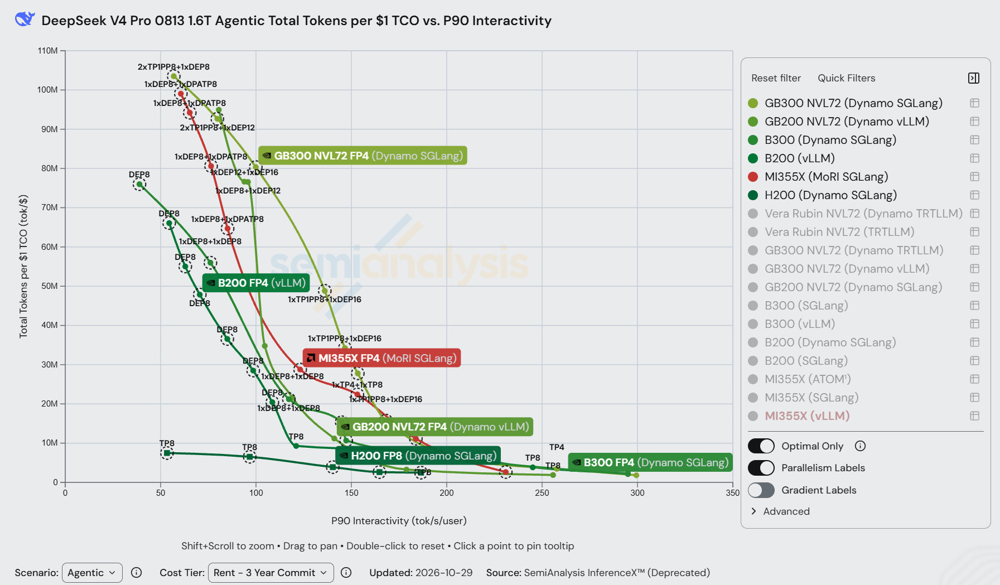
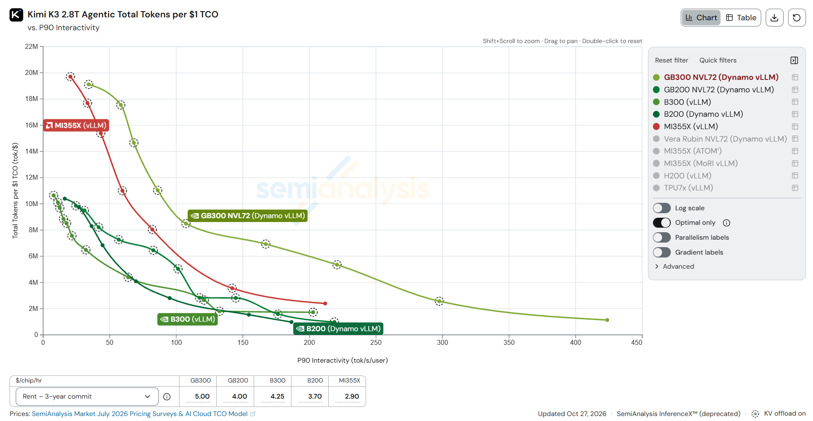
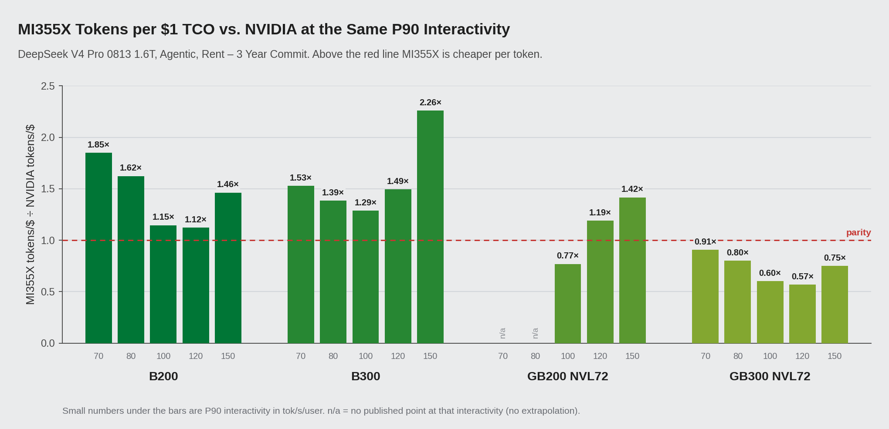
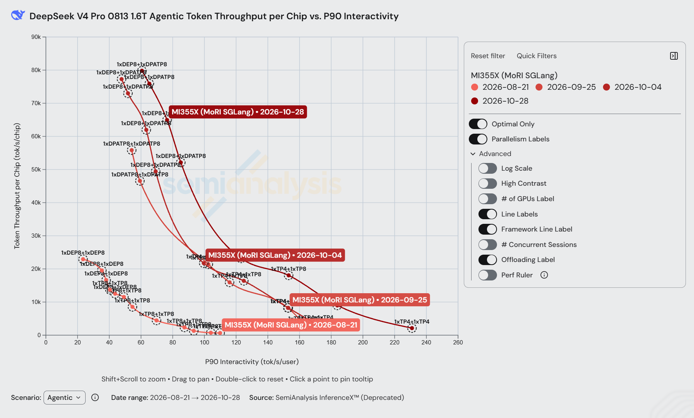
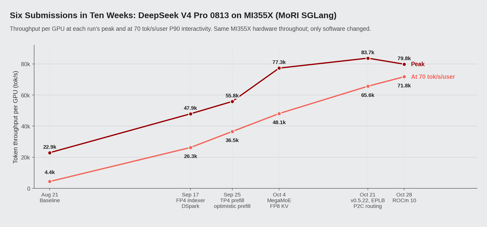
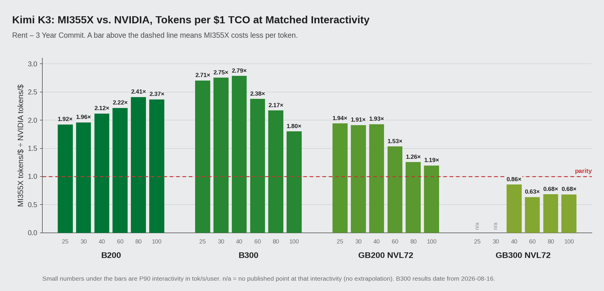
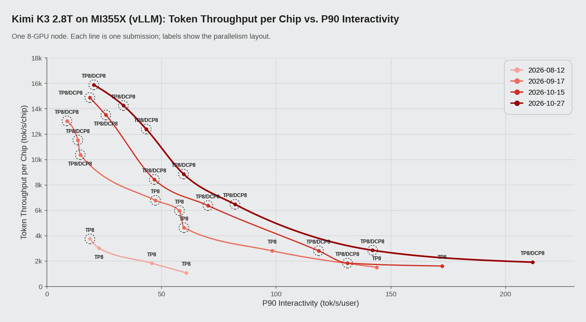
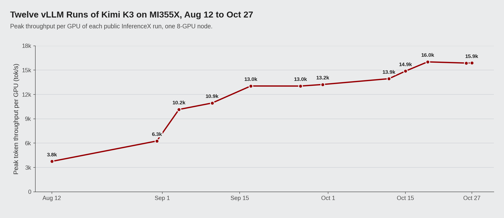

# AMD Instinct™ MI355X on Agentic Inference: DeepSeek-V4-Pro and Kimi-K3 at Up to 2.4× the Tokens per Dollar of B200

*November 2026*

Since August we have been running two large MoE models on AMD Instinct MI355X in SemiAnalysis's public AgentX benchmark: DeepSeek-V4-Pro (1.6T) on SGLang with MoRI, and Kimi-K3 (2.8T) on vLLM. On both, MI355X now gets more tokens per dollar than B200 and B300 across nearly all of the interactivity range where they overlap; the one exception is DeepSeek-V4-Pro at the single-user end, above about 220 tok/s/user. In the comparisons below, the lead on DeepSeek-V4-Pro goes up to 1.85× over B200 and 2.26× over B300. On Kimi-K3 it is 1.9–2.4× over B200 and 1.8–2.8× over B300, MI355X also leads GB200 NVL72 by 1.2–1.9×, and its peak tokens per dollar is the highest on the dashboard.

*Figure 1: DeepSeek-V4-Pro FP4 AgentX, total tokens per $1 TCO vs. P90 interactivity, Rent – 3-year commit tier, screenshot of the [InferenceX dashboard](https://inferencex.semianalysis.com/inference/deepseek-v4) (data updated 2026-10-29). One framework is shown per system: GB300 NVL72 and B300 on Dynamo SGLang, GB200 NVL72 on Dynamo vLLM, B200 on vLLM, H200 on Dynamo SGLang, and MI355X on MoRI SGLang (red). For MI355X, KV offload is MoRI UMBP.*

*Figure 2: Kimi-K3 FP4 AgentX, total tokens per $1 TCO vs. P90 interactivity, Rent – 3-year commit tier, screenshot of the [InferenceX dashboard](https://inferencex.semianalysis.com/inference/kimi-k3) (updated 2026-10-27). One framework is shown per system: GB300 NVL72, GB200 NVL72 and B200 on Dynamo vLLM, and B300 and MI355X on vLLM. Dashed circles mark points with KV offload on.*

Most of that lead came from software: on the same hardware, peak throughput per GPU rose 3.5× on DeepSeek-V4-Pro and 4.2× on Kimi-K3 between August and October.

First we look at the benchmark and the MI355X hardware. Then, for each model, we compare MI355X with NVIDIA's GPUs, show how the results improved since August, and explain which changes made the difference.

## The workload and the hardware

AgentX is a SemiAnalysis benchmark built from real agentic coding sessions and run through the public InferenceX CI. It replays whole sessions: each turn adds tool output to the context and sends everything back to the model. A session runs about 43 turns, the median turn has 142K input tokens and 444 output tokens, and over 96% of prompt tokens repeat a prefix the server has already processed. Our [earlier article](https://www.amd.com/en/developer/resources/technical-articles/2026/mori-umbp-empowers-amd-instinct-gpus.html) describes the benchmark in more detail.

For the hardware, what matters most is that these long contexts come back turn after turn and keep a lot of model state and KV cache alive at once. That makes memory capacity the first number to look at, and MI355X has the most HBM per GPU of the systems compared here (Table 1).

*Table 1: Per-GPU specifications from the InferenceX GPU specs page, and the Rent – 3-year commit price used for TCO.*

| | MI355X | B200 | B300 | GB200 NVL72 | GB300 NVL72 |
|---|---|---|---|---|---|
| HBM capacity | 288 GB HBM3E | 180 GB | 268 GB | 186 GB | 278 GB |
| HBM bandwidth | 8 TB/s | 8 TB/s | 8 TB/s | 8 TB/s | 8 TB/s |
| Dense FP4 | 10.1 PFLOPS | 9.0 PFLOPS | 13.5 PFLOPS | 10.0 PFLOPS | 15.0 PFLOPS |
| Rent, $/GPU-hour | $2.90 | $3.70 | $4.25 | $4.00 | $5.00 |

That capacity drove most of our deployment choices for both models. DeepSeek-V4-Pro in FP4 fits on four MI355X GPUs with space left for KV cache, so its recipe uses TP4 prefill at concurrency 16–48 and TP4 + TP4 at concurrency 1, where every published B200 AgentX recipe uses eight GPUs per role. Kimi-K3's MXFP4 weights are about 1.56 TB. At TP8 that is about 195 GB per MI355X, so the whole model runs on one 8-GPU node. Eight B200s (1.44 TB) or eight GB200s (1.49 TB) cannot hold the weights, and the published configurations for both spread the model over two nodes with pipeline parallelism.

Compute is a different story. B300 has about a third more dense FP4 than MI355X, yet on DeepSeek-V4-Pro at 70 tok/s/user MI355X runs at 71.8k tok/s per GPU against B300's 68.8k. On Kimi-K3 at 40 tok/s/user it delivers 1.66× B200's throughput per GPU with only 12% more FP4. Closing the distance between what the hardware can do and what each model was getting from it is what most of the work below was about.

## DeepSeek-V4-Pro on SGLang with MoRI UMBP

On DeepSeek-V4-Pro, a large part of that work went into the KV cache. The model runs with SGLang, using MoRI for prefill/decode disaggregation and MoE all-to-all over standard RoCE between 8-GPU nodes. With over 96% prefix reuse, serving cost depends on keeping old KV cache close at hand instead of recomputing it. MoRI UMBP (Unified Memory & Bandwidth Pool) is the KV cache layer the AMD MoRI team built for this. Through the KVCache Store Linker, which we designed with the SGLang community, SGLang's radix tree connects directly to a DRAM pool. The pool is shared across DP ranks and model instances, keeps one copy of the KV that would otherwise be duplicated on every TP rank, and runs outside the engine process, so it survives restarts. With the same recipe, turning MoRI UMBP on gave 8.3% more throughput per GPU and 35% lower P90 TTFT at concurrency 256. Every MI355X point from Sep 25 on, from concurrency 1 to 512, uses it. The [earlier article](https://www.amd.com/en/developer/resources/technical-articles/2026/mori-umbp-empowers-amd-instinct-gpus.html) covers its design and measurements in detail.

### Against NVIDIA

With MoRI UMBP serving every point, Table 2 and Figure 3, along with Figure 1 at the top of this post, show where the MI355X curve sits against NVIDIA's systems.

*Table 2: DeepSeek-V4-Pro, total tokens per $1 TCO in millions (Rent tier).*

| P90 interactivity | MI355X | B200 | B300 | GB200 NVL72 | GB300 NVL72 |
|---|---|---|---|---|---|
| 70 tok/s/user | 89.1 | 48.1 (1.85×) | 58.3 (1.53×) | — | 98.1 (0.91×) |
| 80 tok/s/user | 74.3 | 45.8 (1.62×) | 53.6 (1.39×) | — | 92.5 (0.80×) |
| 100 tok/s/user | 44.8 | 39.1 (1.15×) | 34.8 (1.29×) | 58.2 (0.77×) | 74.1 (0.60×) |
| 120 tok/s/user | 30.2 | 26.9 (1.12×) | 20.2 (1.49×) | 25.3 (1.19×) | 53.0 (0.57×) |
| 150 tok/s/user | 23.2 | 15.9 (1.46×) | 10.3 (2.26×) | 16.4 (1.42×) | 30.9 (0.75×) |
| Peak | 99.1 | 66.1 (1.50×) | 82.7 (1.20×) | 95.0 (1.04×) | 112.8 (0.88×) |

*Figure 3: DeepSeek-V4-Pro, MI355X tokens per dollar divided by each NVIDIA system's tokens per dollar at the same P90 interactivity (Rent tier).*

MI355X is ahead of B200 and B300 at every level in Table 2: 1.12–1.85× B200 and 1.29–2.26× B300 on tokens per dollar. In raw throughput per GPU, MI355X is at most 12% behind either one anywhere in this range, and ahead of both at 70 and 150 tok/s/user. The rest of the tokens-per-dollar lead comes from the lower price. On the Owning cost tier, MI355X still gets 1.67× the tokens per dollar of B200 and 1.57× of B300 at 70 tok/s/user.

Against the 72-GPU NVLink racks the picture is mixed. MI355X has a slightly higher peak than GB200 NVL72 (99.1M vs. 95.0M) and is ahead at 120–150 tok/s/user, while GB200 is ahead around 100 tok/s/user. GB300 NVL72 is ahead at every level; the closest we get is 0.95× of its tokens per dollar, at 65 tok/s/user.

### How the curve evolved in ten weeks

In August the picture was different, and it took ten weeks of software work to change it. Our first full AgentX run for this model on MI355X, on Aug 21, peaked at 22.9k tokens/s per GPU. By Oct 28, on the same hardware, the peak was 79.8k, 3.5× higher, and peak tokens per $1 TCO had gone from 28.5M to 99.1M. At 70 tok/s/user the gain is 16×, from 4.4k to 71.8k tokens/s per GPU. Figure 4 shows how the curve moved, and Figure 5 tracks every submission.

*Figure 4: Throughput per GPU vs. P90 interactivity for the MI355X MoRI-SGLang AgentX recipe, screenshot of the [InferenceX dashboard](https://inferencex.semianalysis.com/inference/deepseek-v4) showing the runs on [Aug 21](https://github.com/SemiAnalysisAI/InferenceX/actions/runs/32269076444/attempts/4), [Sep 25](https://github.com/SemiAnalysisAI/InferenceX/actions/runs/35879254139/attempts/1), [Oct 4](https://github.com/SemiAnalysisAI/InferenceX/actions/runs/37181045340/attempts/1) and [Oct 28](https://github.com/SemiAnalysisAI/InferenceX/actions/runs/40473082761/attempts/4). Dashed circles mark KV offload, which is MoRI UMBP from Sep 25 on.*

*Figure 5: Peak throughput per GPU and throughput at 70 tok/s/user for each of the six DeepSeek-V4-Pro submissions.*

There were six submissions in those ten weeks, and after mid-September a new one landed every one to two weeks. Every run raised throughput at 70 tok/s/user, by 9–39% per run after Sep 17, and the biggest jumps in peak came on Sep 17 (2.1×) and Oct 4 (1.4×). The later runs did more for per-user speed than for peak: from Oct 4 to Oct 28, throughput at concurrency 192 rose 5% while its P90 interactivity went from 69.3 to 85.1 tok/s/user. Some of the gains also came with fewer GPUs: at concurrency 16–48 the recipe now uses 12 GPUs instead of 16.

### Key optimizations

The optimizations span kernels, memory, scheduling and the platform. Table 3 lists them, roughly from the largest measured effect to the smallest. All of them are in the public SGLang ROCm images (`lmsysorg/sglang-rocm`) and the [InferenceX recipes](https://github.com/SemiAnalysisAI/InferenceX).

*Table 3: DeepSeek-V4-Pro optimizations and their measured effect. Throughput is per GPU. The concurrency-192 numbers come from the intermediate CI sweeps for [InferenceX PR #2823](https://github.com/SemiAnalysisAI/InferenceX/pull/2823), on the same 16 GPUs at each step.*

| Optimization | What it does | Where | Measured effect |
|---|---|---|---|
| FP4 sparse-attention indexer, DP attention with EP1 | Runs DeepSeek-V4's DSA indexer on AITER FP4 kernels for gfx950, cutting its KV from 132 B to 68 B per token | AITER, SGLang | +51% throughput at concurrency 192; P90 TTFT 33.6 s → 20.5 s |
| MegaMoEv2 prefill, FP8 KV at concurrency 192–512 | Fuses MoE dispatch, expert GEMM and combine into one FlyDSL kernel with 8-way expert parallelism ([sglang#35619](https://github.com/sgl-project/sglang/pull/35619)); stores the NoPE part of the KV pool in FP8 | AITER (FlyDSL), SGLang | +11% throughput at concurrency 256; concurrency 384–512 usable, peak 55.8k → 77.3k |
| SGLang v0.5.22: FP8 KV at concurrency 1–48, EPLB, power-of-two decode routing | Extends FP8 KV to low concurrency, balances expert load in MegaMoE prefill, and spreads decode load more evenly across DP ranks | SGLang, AITER | Throughput at 70 tok/s/user 48.1k → 65.6k (+36%) |
| MoRI UMBP linker, TP4 prefill | With MoRI UMBP holding KV in DRAM, prefill at concurrency 16–48 drops from TP8 to TP4, 12 GPUs instead of 16 | MoRI, SGLang | +26–34% throughput at concurrency 16–48 on 25% fewer GPUs |
| Optimistic prefill, host-sync removal | Starts prefill without waiting for decode to bootstrap the request, with the request owning its speculative KV; removes a host sync from DSpark prefill | SGLang | P90 TTFT −27.7% at concurrency 256, then another −13–16% at 128–256 |
| ROCm 10 | Moves the image to ROCm 10; peak throughput at concurrency 512 dips from 83.7k to 79.8k in exchange for higher interactivity | ROCm | P90 interactivity +6–17% at concurrency 192–512; throughput at 70 tok/s/user +9% |

## Kimi-K3 on vLLM

Kimi-K3 is where MI355X's memory matters most. It has 2.8T parameters across 896 experts and a native context of 1M tokens. Some of its layers use Kimi Delta Attention (KDA), which carries a recurrent state per request; the rest use MLA with a paged KV cache. A DSpark draft head (Inferact/Kimi-K3-DSpark) comes with it for speculative decoding. For agent traffic the mix is awkward. A returning session needs both its KV pages and its KDA state back, or the prefix gets recomputed, and on AgentX nearly every request is a returning session. We serve it with vLLM on one 8-GPU MI355X node, which, as shown above, B200 and GB200 cannot do.

### Against NVIDIA

Table 4 and Figure 6, along with Figure 2 at the top of this post, put that single node next to NVIDIA's systems.

*Table 4: Kimi-K3, total tokens per $1 TCO in millions at fixed P90 interactivity (Rent tier).*

| P90 interactivity | MI355X | B200 | B300¹ | GB200 NVL72 | GB300 NVL72 |
|---|---|---|---|---|---|
| 25 tok/s/user | 19.1 | 9.9 (1.92×) | 7.1 (2.71×) | 9.8 (1.94×) | — |
| 40 tok/s/user | 16.2 | 7.7 (2.12×) | 5.8 (2.79×) | 8.4 (1.93×) | 18.9 (0.86×) |
| 60 tok/s/user | 10.9 | 4.9 (2.22×) | 4.6 (2.38×) | 7.1 (1.53×) | 17.2 (0.63×) |
| 80 tok/s/user | 8.3 | 3.4 (2.41×) | 3.8 (2.17×) | 6.6 (1.26×) | 12.1 (0.68×) |
| 100 tok/s/user | 6.2 | 2.6 (2.37×) | 3.4 (1.80×) | 5.2 (1.19×) | 9.1 (0.68×) |
| Peak | 19.7 | 10.4 (1.89×) | 10.6 (1.86×) | 9.9 (1.99×) | 19.1 (1.03×) |

¹ B300's latest published Kimi-K3 results are from 2026-08-16; everything else was measured in October.

*Figure 6: Kimi-K3, MI355X tokens per dollar over each NVIDIA system's at the same P90 interactivity (Rent tier). Bars above 1.0 mean a lower cost per token on MI355X.*

B200, B300 and GB200 NVL72 trail MI355X at every level in Table 4, by 1.9–2.4×, 1.8–2.8× and 1.2–1.9×. Against B200 the gap here is mainly throughput, not price: one MI355X GPU does 1.5–1.9× the work of one B200 over this range, 13.1k against 7.9k tokens/s at 40 tok/s/user. Against GB200 it does about 1.4× the work at 25–40 tok/s/user. Owning-tier prices narrow the lead a little, to 1.7–2.2× over B200 and 1.1–1.7× over GB200.

GB300 NVL72 is the exception again. From 40 tok/s/user up it gets more tokens per dollar, with MI355X at 0.63–0.86× of it, using disaggregated wide-EP setups of 24 to 40 GPUs within the NVLink rack. At the low-interactivity end the MI355X peak, 19.7M at 20.5 tok/s/user, edges past GB300's 19.1M.

### Same eight GPUs, 4.2× the throughput

As with DeepSeek-V4-Pro, this lead is recent. The first vLLM run of Kimi-K3 AgentX on MI355X went in on Aug 12, two weeks after the first NVIDIA result, and peaked at 3.8k tokens/s per GPU. By Oct 27 the peak was 15.9k. The gain is bigger at moderate interactivity: at 40 tok/s/user, throughput went from 2.1k to 13.1k tokens/s per GPU, and single-user speed went from 61 to 212 tok/s/user. Figure 7 shows four of the twelve runs and Figure 8 shows the peak of every one.

*Figure 7: Kimi-K3 throughput per GPU against P90 interactivity for four of the vLLM runs. Labels give the parallelism layout (TP8, or TP8 with 8-way decode context parallelism); a dashed ring means the point used the DRAM KV tier.*

*Figure 8: Peak throughput per GPU of all twelve Kimi-K3 vLLM runs.*

Most of the peak gain came early. Within three weeks, decode context parallelism and a DRAM KV tier made concurrency 44–52 practical and took the peak from 3.8k to 10.2k. Later runs moved the peak less but kept lifting the middle of the curve, by up to 19% per run at 40 tok/s/user.

### Key optimizations

Table 5 ranks the vLLM changes behind that climb by measured effect. They ship in the public `vllm/vllm-openai-rocm` nightly images and are wired up in the InferenceX recipes.

*Table 5: Kimi-K3 vLLM changes on MI355X ranked by effect, throughput per GPU. Values at a given tok/s/user are read off each run's curve.*

| Change | What it does | Components | Effect |
|---|---|---|---|
| DCP8 and a DRAM KV tier | Splits the decode KV read across all eight GPUs and moves KV pages that don't fit in HBM to about 225 GB of DRAM per rank, so concurrency up to 60 fits on one node | vLLM, AITER | At 40 tok/s/user 2.1k → 6.9k; peak 3.8k → 10.2k |
| AITER MLA for the DSpark draft | Moves the draft model's attention from Triton MLA to AITER MLA ([vllm#55966](https://github.com/vllm-project/vllm/pull/55966)) | vLLM, AITER | +28.9% P90 interactivity and +14.5% throughput at concurrency 1 |
| DCP8 at nearly every point, AITER ASM verify | Uses DCP8 at almost every concurrency; the multi-token verify step for speculative decoding runs on an AITER ASM kernel | vLLM, AITER | +26% at 20 tok/s/user |
| AITER Gluon KDA kernels, low-latency MoE router GEMM | Gluon kernels for KDA decode and speculative decode ([vllm#57392](https://github.com/vllm-project/vllm/pull/57392)); a router GEMM for any input shape ([vllm#61895](https://github.com/vllm-project/vllm/pull/61895)) | vLLM, AITER | +19% at 40 tok/s/user; peak 14.9k → 16.0k |
| Persistent FlyDSL decode kernels at concurrency 1 | Runs each MoE decoder layer as one persistent kernel with the TP all-reduce inside it ([vllm#60683](https://github.com/vllm-project/vllm/pull/60683)) | vLLM, FlyDSL | Single-user speed 178 → 211 tok/s/user |
| FP8 fusions, latent-MoE local shards | Fuses AttnRes output with per-token FP8 quantization ([vllm#59069](https://github.com/vllm-project/vllm/pull/59069)); latent-MoE up-projections keep only the local rank's shards ([vllm#59591](https://github.com/vllm-project/vllm/pull/59591)) | vLLM | +17% at 30 tok/s/user; peak 13.9k → 14.9k |
| Tail-aware admission caps | The slowest 10% of decode steps fell in the largest batches, so running sequences at concurrency 4–32 are capped below that size | vLLM | +15% at 40 tok/s/user, +17% at 60 tok/s/user |

## Acknowledgements

Thanks to the SGLang and vLLM communities for design reviews and quick upstreaming, to Moonshot AI, to Inferact for the DSpark draft model, to SemiAnalysis for AgentX and the InferenceX CI infrastructure, and to the AMD MoRI, SGLang, AITER, vLLM and ROCm teams.

## References

1. SemiAnalysis InferenceX, DeepSeek-V4 dashboard. https://inferencex.semianalysis.com/inference/deepseek-v4
2. SemiAnalysis InferenceX, Kimi-K3 dashboard. https://inferencex.semianalysis.com/inference/kimi-k3
3. SemiAnalysis AI Cloud TCO Model (source of the $/GPU/hr rates). https://semianalysis.com/ai-cloud-tco-model/
4. AMD, *MoRI UMBP Empowers AMD Instinct™ MI355X GPU to Demonstrate Token-per-Dollar TCO Leadership on the Public AgentX Leaderboard*. https://www.amd.com/en/developer/resources/technical-articles/2026/mori-umbp-empowers-amd-instinct-gpus.html
5. AMD, *Rebuilding Agentic AI from First Principles for AMD GPU*, with Moonshot AI. https://www.amd.com/en/developer/resources/technical-articles/2026/rebuilding-agentic-ai-for-amd-gpu.html
6. InferenceX recipe history for DeepSeek-V4-Pro on MI355X: PRs [#2823](https://github.com/SemiAnalysisAI/InferenceX/pull/2823), [#3188](https://github.com/SemiAnalysisAI/InferenceX/pull/3188), [#3256](https://github.com/SemiAnalysisAI/InferenceX/pull/3256), [#3664](https://github.com/SemiAnalysisAI/InferenceX/pull/3664), [#4186](https://github.com/SemiAnalysisAI/InferenceX/pull/4186), [#4571](https://github.com/SemiAnalysisAI/InferenceX/pull/4571).
7. InferenceX recipe history for Kimi-K3 on MI355X with vLLM: PRs [#2508](https://github.com/SemiAnalysisAI/InferenceX/pull/2508), [#2787](https://github.com/SemiAnalysisAI/InferenceX/pull/2787), [#2810](https://github.com/SemiAnalysisAI/InferenceX/pull/2810), [#3124](https://github.com/SemiAnalysisAI/InferenceX/pull/3124), [#3833](https://github.com/SemiAnalysisAI/InferenceX/pull/3833), [#3951](https://github.com/SemiAnalysisAI/InferenceX/pull/3951), [#4215](https://github.com/SemiAnalysisAI/InferenceX/pull/4215), [#4393](https://github.com/SemiAnalysisAI/InferenceX/pull/4393), [#4473](https://github.com/SemiAnalysisAI/InferenceX/pull/4473).
