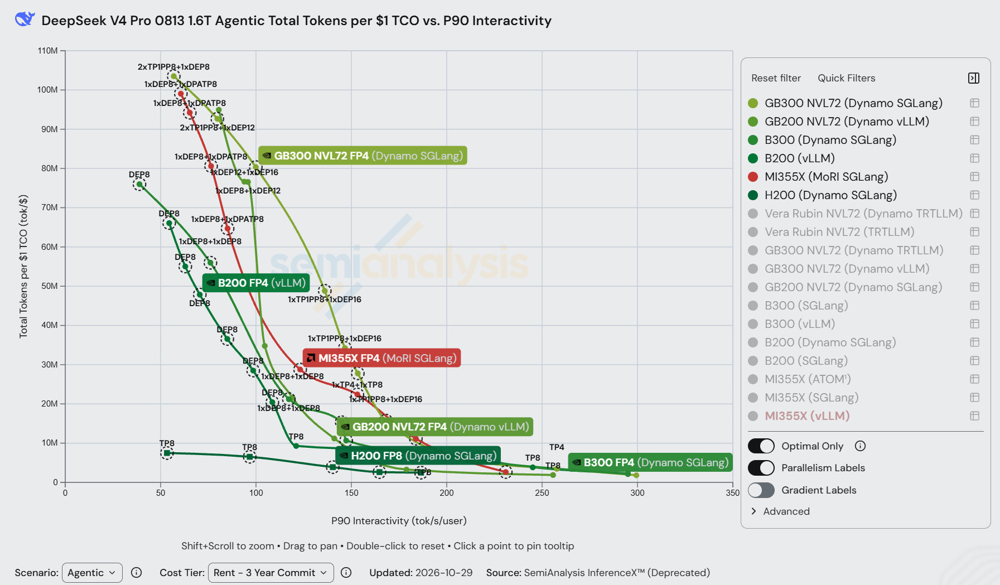
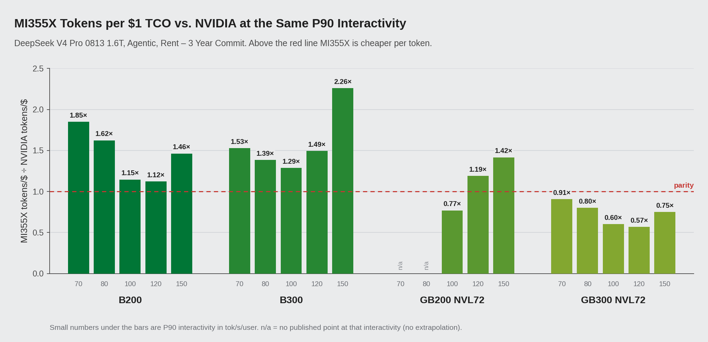
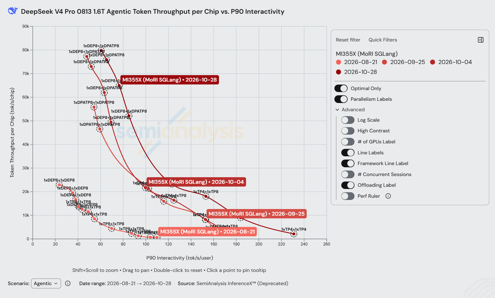
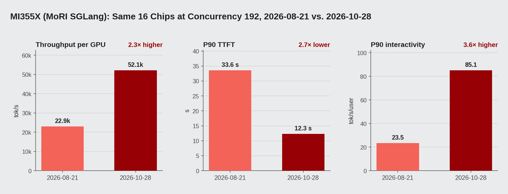
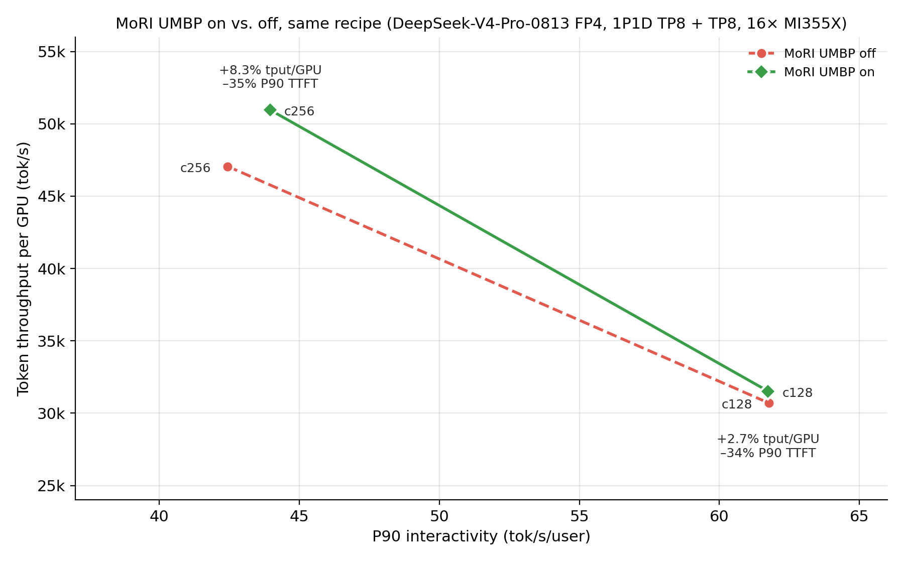
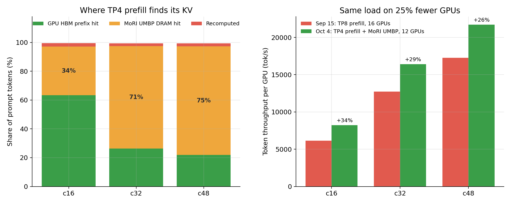

# 重新定义智能体推理的性价比：AMD Instinct™ MI355X 运行 DeepSeek-V4-Pro，每美元 token 产出最高达 B200 的 1.85 倍

*2026 年 10 月*

从 8 月开始，我们一直在 SemiAnalysis 的公开基准 AgentX 上用 AMD Instinct MI355X 跑 DeepSeek-V4-Pro（1.6T，FP4）。服务栈是 SGLang，用 MoRI 做 prefill/decode 分离，用 MoRI UMBP 做 KV cache 池。按 10 月 28 日最新一次运行，InferenceX dashboard 上 MI355X 每 1 美元 TCO 的总 token 数峰值为 9910 万。B200 已公开的最好成绩是 6610 万，B300 是 8270 万，MI355X 分别是它们的 1.50 倍和 1.20 倍；GB200 NVL72 的峰值是 9500 万。以上都按 Rent（3 年承诺）成本档位计算，数据获取于 2026-10-30。

只看峰值看不出各家是在曲线哪个位置拿到的，所以本文主要在相同交互速度下比较。70 tok/s/用户时，MI355X 每美元 token 产出是 B200 的 1.85 倍、B300 的 1.53 倍。GB300 NVL72 在这个基准上仍然领先我们，具体差多少下文会给出。

另一件想说明的事，是这些结果里有多少是在很短时间内靠软件做出来的。8 月 21 日这套配方的单卡吞吐峰值是 22.9k tok/s，10 月 28 日是 79.8k，用的是同一批卡。

*图 1：DeepSeek-V4-Pro FP4 AgentX，「每 1 美元 TCO 总 token 数」vs.「P90 交互速度」，Rent – 3 年承诺档位。[InferenceX dashboard](https://inferencex.semianalysis.com/inference/deepseek-v4) 截图（数据更新于 2026-10-29）。每个系统只显示一个框架：GB300 NVL72 和 B300 为 Dynamo SGLang，GB200 NVL72 为 Dynamo vLLM，B200 为 vLLM，H200 为 Dynamo SGLang，MI355X 为 MoRI SGLang（红色）。数据点标签是并行布局。表 1 对每个 NVIDIA 系统取所有已公开框架里的最好点，所以表中 B300 和 GB300 的峰值（分别来自 B300 SGLang 和 GB300 Dynamo vLLM）比图中曲线更高。*

## 关于这个基准

AgentX 回放的是真实的 agentic 编程会话：每一轮把工具输出拼到上下文后面，再整个发给模型。一个会话大约 43 轮，单轮输入中位数 142K token、输出 444 token，超过 96% 的 prompt token 是服务端已经处理过的前缀。配方、日志和结果全部公开，本文的数字谁都可以复核。

文中用到 dashboard 的两个口径。P90 交互速度是完整响应 P90 token 间延迟的倒数，单位 tok/s/用户；智能体要等完整回复才能进行下一步，所以看的是这个延迟。每 1 美元 TCO 的 token 数，是单卡总吞吐（含命中缓存的 token）除以 SemiAnalysis AI Cloud TCO Model 给出的每卡每小时成本。Rent 档位下，MI355X 是 $2.90，B200 $3.70，B300 $4.25，GB200 $4.00，GB300 $5.00；Owning 档位下分别是 $1.50、$1.73、$2.26、$1.86、$2.31。

## 相同交互速度下的对比

表 1 在几个固定的交互速度上读取各系统前沿的数值，插值方法和 dashboard 画图用的样条一致，超出实测范围的不做外推。

*表 1：每 1 美元 TCO 总 token 数（百万，Rent 档位）。「—」表示该系统在这个交互速度没有公开数据点；括号内是 MI355X 与该系统之比。*

| P90 交互速度 | MI355X | B200 | B300 | GB200 NVL72 | GB300 NVL72 |
|---|---|---|---|---|---|
| 70 tok/s/用户 | 89.1 | 48.1 (1.85×) | 58.3 (1.53×) | — | 98.1 (0.91×) |
| 80 tok/s/用户 | 74.3 | 45.8 (1.62×) | 53.6 (1.39×) | — | 92.5 (0.80×) |
| 100 tok/s/用户 | 44.8 | 39.1 (1.15×) | 34.8 (1.29×) | 58.2 (0.77×) | 74.1 (0.60×) |
| 120 tok/s/用户 | 30.2 | 26.9 (1.12×) | 20.2 (1.49×) | 25.3 (1.19×) | 53.0 (0.57×) |
| 150 tok/s/用户 | 23.2 | 15.9 (1.46×) | 10.3 (2.26×) | 16.4 (1.42×) | 30.9 (0.75×) |
| 峰值 | 99.1 | 66.1 (1.50×) | 82.7 (1.20×) | 95.0 (1.04×) | 112.8 (0.88×) |

*图 2：相同 P90 交互速度下，MI355X 与各 NVIDIA 系统每美元 token 数之比（Rent 档位）。高于 1.0 说明 MI355X 每 token 更便宜。*

最直接的对比对象是 B200 和 B300，它们同样是 8 卡服务器。表中每个交互速度下 MI355X 都领先这两者：对 B200 是 1.12–1.85 倍，对 B300 是 1.29–2.26 倍。卡更便宜是一部分原因，但不是全部。70 tok/s/用户时，MI355X 的单卡吞吐是 B200 的 1.45 倍（71.8k 对 49.5k tok/s），也比 B300（68.8k）略高。换成 Owning 档位，70 tok/s/用户下仍然是 B200 的 1.67 倍、B300 的 1.57 倍。

和 GB200 NVL72 比则互有胜负。MI355X 峰值略高（9910 万对 9500 万），120–150 tok/s/用户区间领先 1.19–1.42 倍，但 100 tok/s/用户附近是 GB200 更好。另外要注意，GB200 是 72 卡的 NVLink 整机柜，我们用的是通过 RoCE 互联的 8 卡节点。

GB300 NVL72 在所有交互速度下都领先，MI355X 的每美元 token 数是它的 0.57–0.95 倍。最接近的是高吞吐一端：65 tok/s/用户时 0.95 倍，70 时 0.91 倍。每次新的运行，这个差距都在缩小。

## 同一套硬件上的十周

图 3 是 8 月到 10 月 MoRI-SGLang 配方在 MI355X 上的几次主要提交。

*图 3：MI355X MoRI-SGLang AgentX 配方的单卡吞吐 vs. P90 交互速度，[InferenceX dashboard](https://inferencex.semianalysis.com/inference/deepseek-v4) 截图，包含以下几次运行：[8 月 21 日](https://github.com/SemiAnalysisAI/InferenceX/actions/runs/32269076444/attempts/4)、[9 月 25 日](https://github.com/SemiAnalysisAI/InferenceX/actions/runs/35879254139/attempts/1)、[10 月 4 日](https://github.com/SemiAnalysisAI/InferenceX/actions/runs/37181045340/attempts/1)、[10 月 28 日](https://github.com/SemiAnalysisAI/InferenceX/actions/runs/40473082761/attempts/4)。*

单卡吞吐峰值从 22.9k 升到 79.8k tok/s（3.5 倍），每美元 token 数峰值从 2850 万升到 9910 万。交互速度越高，变化越大：8 月时这套配方只有在很低并发下才能达到 70 tok/s/用户，单卡吞吐 4.4k；现在同样的交互速度下是 71.8k。

图 4 单看一个点：16 张卡、并发 192。单卡吞吐提升 2.3 倍；P90 TTFT 从 33.6 s 降到 12.3 s，首 token 快了 2.7 倍；P90 交互速度从 23.5 升到 85.1 tok/s/用户，提升 3.6 倍。

*图 4：16 张 MI355X、并发 192，8 月 21 日与 10 月 28 日对比。*

## MoRI UMBP

超过 96% 的 prompt token 都已经算过，所以 AgentX 的服务成本主要取决于缓存的 KV 放在哪、多快能拿回来。我们遇到三个问题。一是 HBM 放不下：同时打开的长会话很多，加上并行的子智能体，即便并发不高，大部分可复用的 KV 也早被挤出显存。二是 DeepSeek-V4 稀疏注意力下，MLA latent 和 DSA indexer 的 KV 在每个 TP rank 上都完整存一份。三是放在引擎进程里的 host 缓存，每次重启或升级都会丢。

MoRI UMBP（Unified Memory & Bandwidth Pool）是 AMD MoRI 团队为这类负载做的 KV cache 层，最早和 Moonshot AI 一起在 [*Rebuilding Agentic AI from First Principles for AMD GPU*](https://www.amd.com/en/developer/resources/technical-articles/2026/rebuilding-agentic-ai-for-amd-gpu.html) 里介绍过。之后我们和 SGLang 的维护者一起设计了 KVCache Store Linker，让 SGLang 的 radix tree 直接对接分布式 DRAM 池，不再经过每个 rank 各自的 L2 host 缓存。前缀命中时，prefill 直接从 DRAM 读 KV 页，不用重算。

这个设计里有几点对 AgentX 比较关键。DRAM 池在 DP rank 之间、模型实例之间共享，所以 DP 用 round-robin 路由也能命中缓存。KV 在 HBM 和 DRAM 之间直接搬运，并且按层加载，靠批处理、层分组、ranged API 和一个 GPU gather kernel 压低每层请求的开销。被复制的 MLA/DSA KV 只存一份而不是每个 TP rank 一份，TP8 下有效 DRAM 容量相当于扩大 8 倍，PCIe 流量也降到 1/8。放置和淘汰基于全局信息，而不是各 rank 自己决定。standalone 模式下 KV 池跑在每个节点独立的进程里，引擎重启后缓存还在。

即使在 DRAM 几乎没派上用场的场景，linker 也有收益。在同一配方（1P1D，TP8 + TP8，16 卡）的开关对照里，HBM 服务了约 95.6% 的 prompt token，DRAM 不到 1%；打开 MoRI UMBP 后，并发 256 下单卡吞吐仍提升 8.3%，P90 TTFT 降低 35%（图 5）。收益来自去掉了中间的 host 层和它的 load/offload 开销。

*图 5：同一配方下 MoRI UMBP 关闭与开启时的单卡吞吐 vs. P90 交互速度，并发 128 和 256。*

有效缓存变大以后，部署方式也可以跟着改。prefill 不再需要靠 TP8 来装 KV，所以在并发 16–48，我们用 12 卡的 TP4 prefill + TP8 decode 替代 16 卡的 TP8 + TP8，单卡吞吐提升 26–34%，卡还少了 25%（图 6）。10 月 28 日的运行里，低并发也开了 FP8 KV，HBM 能留住更多 KV；即便这样，并发 32 和 48 下 MoRI UMBP 仍服务了 38% 和 57% 的 prompt token，重算的约 7%。

*图 6：左：TP4 prefill 下每个 prompt token 的 KV 来源（GPU HBM、MoRI UMBP DRAM 或重算）。右：16 卡 TP8 + TP8 与 12 卡 TP4 prefill + MoRI UMBP + TP8 decode 的单卡吞吐对比。*

## AITER 和 SGLang 上的改动

以下改动都在公开的 SGLang ROCm 镜像（`lmsysorg/sglang-rocm`）和 [InferenceX 配方](https://github.com/SemiAnalysisAI/InferenceX)里，大致按合入顺序排列。

注意力部分改动最大的一项，是把 DeepSeek-V4 的 DSA indexer 放到 gfx950 的 AITER FP4 kernel 上跑。indexer 在每一层要给每个 query token 对整个上下文打分，还有自己的逐 token KV，这项改动把它从每 token 132 B 降到 68 B。HBM 能多放序列，每个 decode step 的 indexer 带宽变少，MoRI 在 prefill 和 decode 之间要传的数据也少了。我们还在 unified-KV kernel 上把 KV 池拆成 FP8 的 NoPE 部分和 BF16 的 RoPE 部分，最初只用在并发 192–512，现在并发 1–48 也用上了。MLA decode 的 split-K 系数改成按 index stream 分别选择（比如 compress-ratio-128 的 HCA stream），因为同一个模型里不同层的 KV 长度能差好几个数量级。

MoE 部分，并发 192–512 的 prefill 用 AITER 的 MegaMoEv2 kernel（[sglang#35619](https://github.com/sgl-project/sglang/pull/35619)），用 FlyDSL 写成，把 dispatch、GEMM、combine 融合在一起，基于 MoRI 对称堆做 8 路专家并行。配合 FP8 KV，并发 256 的单卡吞吐提升 11%，曲线也延伸到了并发 384 和 512。并发 512 时 MegaMoE prefill 还开了专家并行负载均衡（EPLB）。

SGLang 调度这边，投机解码从 EAGLE/MTP 换成了 DSpark，用 DeepSeek-V4-Pro-0813 自带的 draft head 一次生成一整块草稿 token，低并发草稿长度用 6，高并发用 3。PD 分离里，请求通常要等 decode 完成 bootstrap 才开始 prefill，高并发下这段时间纯粹是在排队。让 prefill 乐观先行、投机 KV 归请求自己持有之后，并发 256 下 P90 TTFT 降低 27.7%；再去掉 DSpark prefill slot 扩展里的一次 host 同步，并发 128–256 又降了 13–16%。decode 的路由之前一直悄悄沿用了 prefill 的 consistent-hashing 策略，现在改成 round-robin，10 月 21 日起并发 192–512 用 power-of-two-choices。

MoRI 同时负责 PD 的 KV 传输和 MoE all-to-all，8 卡节点之间走标准 RoCE。最后，10 月 28 日的镜像（`v0.5.22-rocm10-mi35x-20261026`）换到了 ROCm 10。和一周前的 ROCm 7.2 版本比，所有高并发点的 P90 交互速度都有提升，并发 512 从 51.8 升到 60.6 tok/s/用户，单卡吞吐则略有下降，从 83.7k 到 79.8k tok/s。

## 总结

在 DeepSeek-V4-Pro AgentX 上，MI355X 每 1 美元 TCO 峰值 9910 万 token，是 B200 的 1.50 倍、B300 的 1.20 倍，略高于 GB200 NVL72；相同交互速度下最高是 B200 的 1.85 倍、B300 的 2.26 倍。GB300 NVL72 仍然领先，我们最接近的是 65 tok/s/用户时的 0.95 倍。同一批卡上，十周内单卡吞吐峰值提升了 3.5 倍。

MoRI UMBP 和 KVCache Store Linker 已经合入 SGLang 上游，AITER kernel 随 ROCm SGLang 镜像发布，所有配方和日志都在公开的 InferenceX CI 里。接下来我们会把 MoRI UMBP 接到 ATOM、vLLM 和 llm-d 上，并把同样的方法用到更新的 agentic 模型。

## 致谢

感谢 SGLang 社区的设计评审和快速合入，感谢 SemiAnalysis 提供 AgentX 和 InferenceX CI 基础设施，也感谢 AMD MoRI、SGLang、AITER 和 ROCm 团队。

## 参考资料

1. SemiAnalysis InferenceX，DeepSeek-V4 dashboard。https://inferencex.semianalysis.com/inference/deepseek-v4
2. SemiAnalysis AI Cloud TCO Model（$/GPU/hr 价格来源）。https://semianalysis.com/ai-cloud-tco-model/
3. AMD，*Rebuilding Agentic AI from First Principles for AMD GPU*，与 Moonshot AI 联合发布。https://www.amd.com/en/developer/resources/technical-articles/2026/rebuilding-agentic-ai-for-amd-gpu.html
4. MoRI UMBP 在 DeepSeek-V4 PD 分离上的实践（前一篇文章）。https://github.com/ichbinblau/dsv4-pd-disagg/tree/main/dsv4-umbp
5. 本基准的 InferenceX 配方演进：PR [#2823](https://github.com/SemiAnalysisAI/InferenceX/pull/2823)、[#3188](https://github.com/SemiAnalysisAI/InferenceX/pull/3188)、[#3256](https://github.com/SemiAnalysisAI/InferenceX/pull/3256)、[#3664](https://github.com/SemiAnalysisAI/InferenceX/pull/3664)、[#4186](https://github.com/SemiAnalysisAI/InferenceX/pull/4186)、[#4571](https://github.com/SemiAnalysisAI/InferenceX/pull/4571)。
