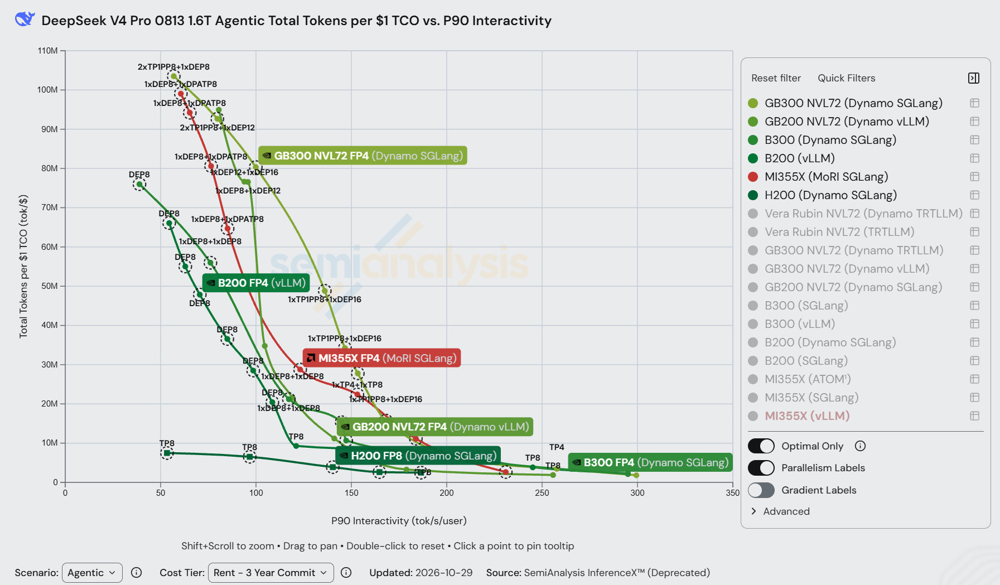
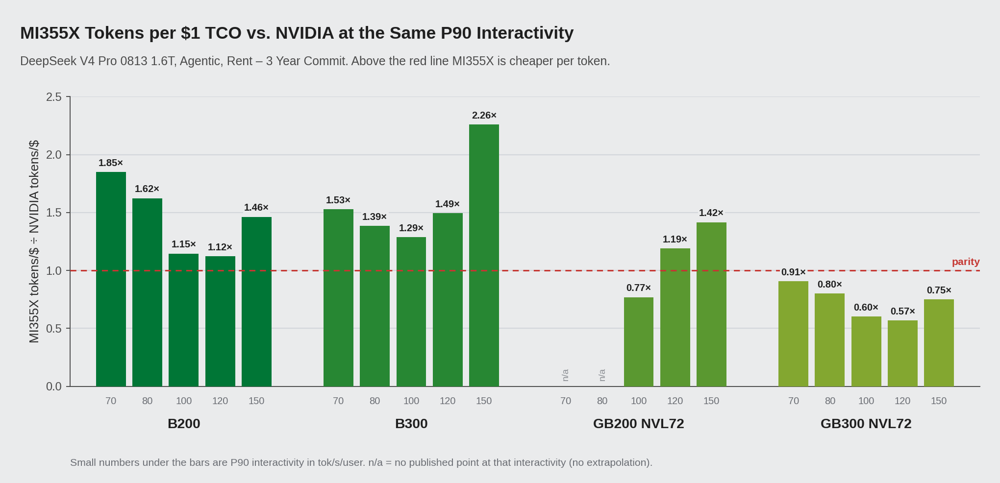
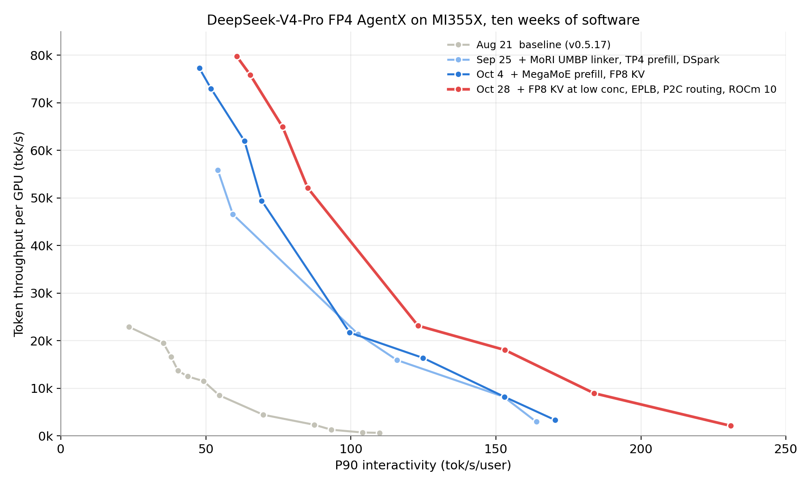
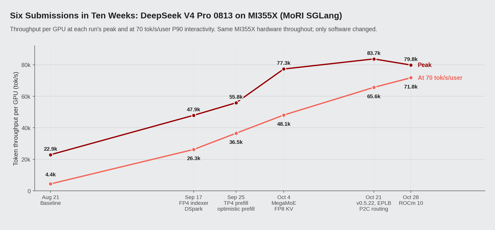

# 3.5× in Ten Weeks: AMD Instinct™ MI355X Overtakes B200 and B300 on DeepSeek-V4-Pro Agentic Inference Cost

*November 2026*

On SemiAnalysis's public InferenceX dashboard for DeepSeek-V4-Pro (1.6T, FP4) agentic inference, AMD Instinct MI355X now gets more tokens per dollar than B200 and B300 at every interactivity level where both have published results. The lead goes up to 1.85× over B200 and 2.26× over B300. Peak tokens per $1 TCO is 99.1M, 1.50× B200 and 1.20× B300.

We got here in ten weeks, from Aug 21 to Oct 28, with software work on the same hardware; over that time peak throughput per GPU went up 3.5×.

The AgentX benchmark and MoRI UMBP, the KV cache layer this work runs on, are described in detail in our [earlier article](https://www.amd.com/en/developer/resources/technical-articles/2026/mori-umbp-empowers-amd-instinct-gpus.html); the next section gives a short summary. Here we focus on the GPU itself, the kernel and scheduling work we did on top of it, and how those changes added up over ten weeks.

*Figure 1: DeepSeek-V4-Pro FP4 AgentX, total tokens per $1 TCO vs. P90 interactivity, Rent – 3-year commit tier, screenshot of the [InferenceX dashboard](https://inferencex.semianalysis.com/inference/deepseek-v4) (data updated 2026-10-29). One framework is shown per system: GB300 NVL72 and B300 on Dynamo SGLang, GB200 NVL72 on Dynamo vLLM, B200 on vLLM, H200 on Dynamo SGLang, and MI355X on MoRI SGLang (red). Dashed circles mark points with KV offload on; for MI355X that is MoRI UMBP. Table 1 uses each NVIDIA system's best framework, so its B300 and GB300 peaks are higher than the curves shown here.*

## AgentX and MoRI UMBP in brief

AgentX is a SemiAnalysis benchmark built from real agentic coding sessions and run through the public InferenceX CI. It replays whole sessions: each turn adds tool output to the context and sends everything back to the model. A session runs about 43 turns, the median turn has 142K input tokens and 444 output tokens, and over 96% of prompt tokens repeat a prefix the server has already processed. 

With that much prefix reuse, serving cost depends on keeping old KV cache close at hand instead of recomputing it. MoRI UMBP (Unified Memory & Bandwidth Pool) is the KV cache layer the AMD MoRI team built for this. Through the KVCache Store Linker, which we designed with the SGLang community, SGLang's radix tree connects directly to a DRAM pool. The pool is shared across DP ranks and model instances, keeps one copy of the KV that would otherwise be duplicated on every TP rank, and runs outside the engine process, so it survives restarts. With the same recipe, turning MoRI UMBP on gave 8.3% more throughput per GPU and 35% lower P90 TTFT at concurrency 256, and together with MI355X's 288 GB of HBM it is what lets prefill at concurrency 16–48 run on four GPUs instead of eight. In the dashboard charts in this post (Figures 1 and 3), a dashed circle around a point means KV offload is on. Every MI355X point from Sep 25 on, from concurrency 1 to 512, uses MoRI UMBP for it. The design and measurements are in the [earlier article](https://www.amd.com/en/developer/resources/technical-articles/2026/mori-umbp-empowers-amd-instinct-gpus.html).

## Comparison with NVIDIA

Table 1 compares systems at fixed interactivity levels. Each system was measured at only a handful of concurrency settings, so its results rarely land exactly on a level such as 70 tok/s/user. We take the value from the curve between the two nearest measured points, the same way the dashboard draws its lines. When a system has no measurements on both sides of a level, we leave the cell empty ("—") instead of guessing.

*Table 1: Total tokens per $1 TCO in millions (Rent tier). "—" means the system has no published point at that interactivity. In parentheses: MI355X divided by that system. For NVIDIA we take the best point across all published frameworks.*

| P90 interactivity | MI355X | B200 | B300 | GB200 NVL72 | GB300 NVL72 |
|---|---|---|---|---|---|
| 70 tok/s/user | 89.1 | 48.1 (1.85×) | 58.3 (1.53×) | — | 98.1 (0.91×) |
| 80 tok/s/user | 74.3 | 45.8 (1.62×) | 53.6 (1.39×) | — | 92.5 (0.80×) |
| 100 tok/s/user | 44.8 | 39.1 (1.15×) | 34.8 (1.29×) | 58.2 (0.77×) | 74.1 (0.60×) |
| 120 tok/s/user | 30.2 | 26.9 (1.12×) | 20.2 (1.49×) | 25.3 (1.19×) | 53.0 (0.57×) |
| 150 tok/s/user | 23.2 | 15.9 (1.46×) | 10.3 (2.26×) | 16.4 (1.42×) | 30.9 (0.75×) |
| Peak | 99.1 | 66.1 (1.50×) | 82.7 (1.20×) | 95.0 (1.04×) | 112.8 (0.88×) |

*Figure 2: MI355X tokens per dollar divided by each NVIDIA system's tokens per dollar at the same P90 interactivity (Rent tier). Above the red line MI355X is cheaper per token.*

MI355X is ahead of B200 and B300 at every level in the table: 1.12–1.85× B200 and 1.29–2.26× B300 on tokens per dollar. In raw throughput per GPU, MI355X is at most 12% behind either one anywhere in this range, and ahead of both at 70 and 150 tok/s/user. The rest of the tokens-per-dollar lead comes from the lower price. On the Owning cost tier, MI355X still gets 1.67× the tokens per dollar of B200 and 1.57× of B300 at 70 tok/s/user.

GB200 NVL72 and GB300 NVL72 are 72-GPU NVLink racks. Against GB200, MI355X has a slightly higher peak (99.1M vs. 95.0M) and is ahead at 120–150 tok/s/user, while GB200 is ahead around 100 tok/s/user. GB300 is ahead at every level. The closest we get is 0.95× of its tokens per dollar, at 65 tok/s/user.

## Six submissions in ten weeks

Our first full AgentX run for this model on MI355X, on Aug 21, peaked at 22.9k tokens/s per GPU. The Oct 28 run, on the same hardware, peaked at 79.8k. At 70 tok/s/user P90 interactivity the change is larger, from 4.4k to 71.8k tokens/s per GPU. Figure 3 shows how the curve moved, and Figure 4 tracks all six submissions from Aug 21 to Oct 28; after mid-September a new one landed every one to two weeks. Each one is a public InferenceX CI run on the same MI355X cluster, and between runs we changed only software and the deployment recipe.

*Figure 3: Throughput per GPU vs. P90 interactivity for the MI355X MoRI-SGLang AgentX recipe, screenshot of the [InferenceX dashboard](https://inferencex.semianalysis.com/inference/deepseek-v4) showing the runs on [Aug 21](https://github.com/SemiAnalysisAI/InferenceX/actions/runs/32269076444/attempts/4), [Sep 25](https://github.com/SemiAnalysisAI/InferenceX/actions/runs/35879254139/attempts/1), [Oct 4](https://github.com/SemiAnalysisAI/InferenceX/actions/runs/37181045340/attempts/1) and [Oct 28](https://github.com/SemiAnalysisAI/InferenceX/actions/runs/40473082761/attempts/4). Dashed circles mark KV offload, which is MoRI UMBP from Sep 25 on.*

*Figure 4: Peak throughput per GPU and throughput at 70 tok/s/user for each of the six submissions.*

The largest jumps in peak throughput came on Sep 17 (2.1×) and Oct 4 (1.4×), but throughput at 70 tok/s/user went up in every run, by 9–39% per run after Sep 17. The later runs did more for per-user speed than for peak: from Oct 4 to Oct 28, throughput at concurrency 192 rose 5% while its P90 interactivity went from 69.3 to 85.1 tok/s/user. That is also why the Oct 28 peak is below Oct 21's, as explained further down.

Part of the Sep 17 gain is not ours. That run also switched to the DeepSeek-V4-Pro-0813 checkpoint, whose bundled draft head has a higher acceptance rate (golden acceptance length 3.01 instead of 2.49). We measured that at about 8% of throughput at concurrency 192.

## MI355X hardware

*Table 2: Per-GPU specifications from the InferenceX GPU specs page, and the Rent – 3-year commit price used for TCO.*

| | MI355X | B200 | B300 |
|---|---|---|---|
| HBM capacity | 288 GB HBM3E | 180 GB | 268 GB |
| HBM bandwidth | 8 TB/s | 8 TB/s | 8 TB/s |
| Dense FP4 | 10.1 PFLOPS | 9.0 PFLOPS | 13.5 PFLOPS |
| Rent, $/GPU-hour | $2.90 | $3.70 | $4.25 |

Memory capacity drove most of our deployment choices. DeepSeek-V4-Pro in FP4 fits on four MI355X GPUs with space left for KV cache, so the recipe uses TP4 prefill at concurrency 16–48 and TP4 + TP4 at concurrency 1. Every published B200 AgentX recipe for this model uses eight GPUs per role. At concurrency 192–512, about 94% of prompt tokens are served from GPU memory, and MoRI UMBP covers the rest from DRAM.

B300 has about a third more dense FP4 compute than MI355X. At 70 tok/s/user, though, MI355X runs at 71.8k tok/s per GPU, a bit more than B300's 68.8k and 1.45× B200's 49.5k. Much of the kernel work described below went into closing the distance between what the hardware can do and what this model was getting from it.

## The optimizations that mattered most

All of the changes below are in the public SGLang ROCm images (`lmsysorg/sglang-rocm`) and the [InferenceX recipes](https://github.com/SemiAnalysisAI/InferenceX). Table 3 lists the ones with the largest measured effect, roughly from biggest to smallest.

*Table 3: Main optimizations and their measured effect. Throughput is per GPU. The concurrency-192 numbers come from the intermediate CI sweeps for [InferenceX PR #2823](https://github.com/SemiAnalysisAI/InferenceX/pull/2823), on the same 16 GPUs at each step; the others compare consecutive public runs. Some runs shipped several changes at once, and those rows give the gain of the bundle.*

| Optimization | Where | Measured effect | Landed |
|---|---|---|---|
| FP4 sparse-attention indexer, DP attention with EP1 | AITER, SGLang | +51% throughput at concurrency 192; P90 TTFT 33.6 s → 20.5 s | Sep 17 |
| MegaMoEv2 prefill, FP8 KV at concurrency 192–512 | AITER (FlyDSL), SGLang | +11% throughput at concurrency 256; concurrency 384–512 usable, peak 55.8k → 77.3k | Oct 4 |
| SGLang v0.5.22: FP8 KV at concurrency 1–48, EPLB, power-of-two decode routing | SGLang, AITER | Throughput at 70 tok/s/user 48.1k → 65.6k (+36%) | Oct 21 |
| MoRI UMBP linker, TP4 prefill | MoRI, SGLang | +26–34% throughput at concurrency 16–48 on 25% fewer GPUs | Sep 17, Sep 25 |
| Optimistic prefill, host-sync removal | SGLang | P90 TTFT −27.7% at concurrency 256, then another −13–16% at 128–256 | Sep 25 |
| ROCm 10 | ROCm | P90 interactivity +6–17% at concurrency 192–512; throughput at 70 tok/s/user +9% | Oct 28 |

### FP4 sparse-attention indexer and DP attention

DeepSeek-V4's DSA indexer scores the whole context for every query token at every layer, and it keeps its own KV for each token. We moved the indexer onto AITER FP4 kernels for gfx950, which takes that KV from 132 B to 68 B per token. More sequences fit in HBM, each decode step reads less indexer data, and MoRI has fewer bytes to send from prefill to decode. The step that brought this change raised throughput per GPU at concurrency 192 by 51%, the largest single step in this work.

### MegaMoEv2 prefill and FP8 KV

At concurrency 192–512, prefill now uses AITER's MegaMoEv2 kernel ([sglang#35619](https://github.com/sgl-project/sglang/pull/35619)). It is written in FlyDSL, fuses dispatch, expert GEMM and combine into one kernel, and runs 8-way expert parallelism over the MoRI symmetric heap. We also split the KV pool into an FP8 NoPE part and a BF16 RoPE part. With both changes, throughput per GPU at concurrency 256 rose 11%, and concurrency 384 and 512 became usable, which took the peak from 55.8k to 77.3k tok/s per GPU. MLA decode also picks its split-K factor per index stream now, since KV lengths in this model vary by orders of magnitude from layer to layer.

### MoRI UMBP and TP4 prefill

Once MoRI UMBP served every point, prefill no longer needed TP8 just to have room for KV. Concurrency 16–48 moved to TP4 prefill with TP8 decode, 12 GPUs instead of 16, and throughput per GPU rose 26–34%.

### Prefill scheduling

In PD disaggregation a request usually waits for decode to bootstrap it before prefill starts, and at high concurrency that wait is pure queueing. With optimistic prefill, where the request owns its speculative KV, P90 TTFT at concurrency 256 dropped 27.7%. Removing a host sync from DSpark prefill slot expansion took off another 13–16% at concurrency 128–256.

### ROCm 10

Moving the image to ROCm 10 (`v0.5.22-rocm10-mi35x-20261026`) raised P90 interactivity by 6–17% at concurrency 192–512 and throughput at 70 tok/s/user by 9%. At concurrency 512, throughput per GPU went down from 83.7k to 79.8k, which is why the Oct 28 peak is below Oct 21's. Where the two runs cover the same interactivity, the Oct 28 curve is higher at every point.

All of these runs use MoRI for the PD KV transfer and the MoE all-to-all, over standard RoCE between 8-GPU nodes, and MoRI UMBP with the SGLang KVCache Store Linker as a shared, deduplicated DRAM KV pool. The [earlier article](https://www.amd.com/en/developer/resources/technical-articles/2026/mori-umbp-empowers-amd-instinct-gpus.html) goes through both in detail.

## Acknowledgements

Thanks to the SGLang community for design reviews and quick upstreaming, to SemiAnalysis for AgentX and the InferenceX CI infrastructure, and to the AMD MoRI, SGLang, AITER and ROCm teams.

## References

1. SemiAnalysis InferenceX, DeepSeek-V4 dashboard. https://inferencex.semianalysis.com/inference/deepseek-v4
2. SemiAnalysis AI Cloud TCO Model (source of the $/GPU/hr rates). https://semianalysis.com/ai-cloud-tco-model/
3. AMD, *MoRI UMBP Empowers AMD Instinct™ MI355X GPU to Demonstrate Token-per-Dollar TCO Leadership on the Public AgentX Leaderboard*. https://www.amd.com/en/developer/resources/technical-articles/2026/mori-umbp-empowers-amd-instinct-gpus.html
4. AMD, *Rebuilding Agentic AI from First Principles for AMD GPU*, with Moonshot AI. https://www.amd.com/en/developer/resources/technical-articles/2026/rebuilding-agentic-ai-for-amd-gpu.html
5. InferenceX recipe history for this benchmark: PRs [#2823](https://github.com/SemiAnalysisAI/InferenceX/pull/2823), [#3188](https://github.com/SemiAnalysisAI/InferenceX/pull/3188), [#3256](https://github.com/SemiAnalysisAI/InferenceX/pull/3256), [#3664](https://github.com/SemiAnalysisAI/InferenceX/pull/3664), [#4186](https://github.com/SemiAnalysisAI/InferenceX/pull/4186), [#4571](https://github.com/SemiAnalysisAI/InferenceX/pull/4571).
