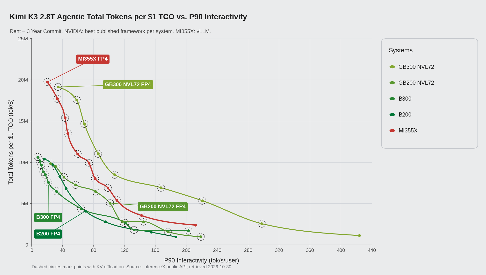
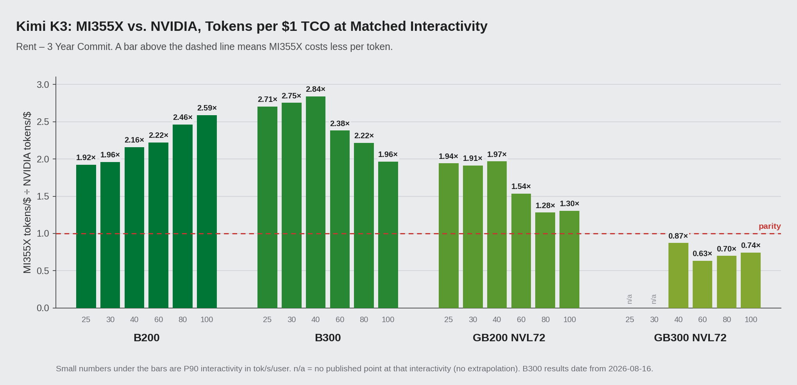
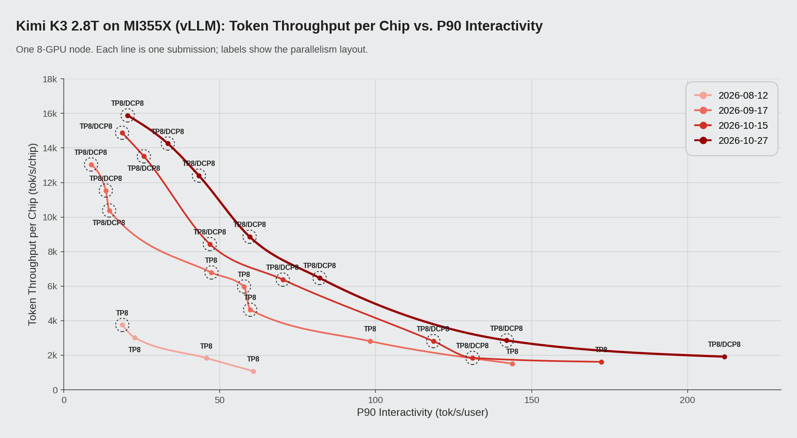
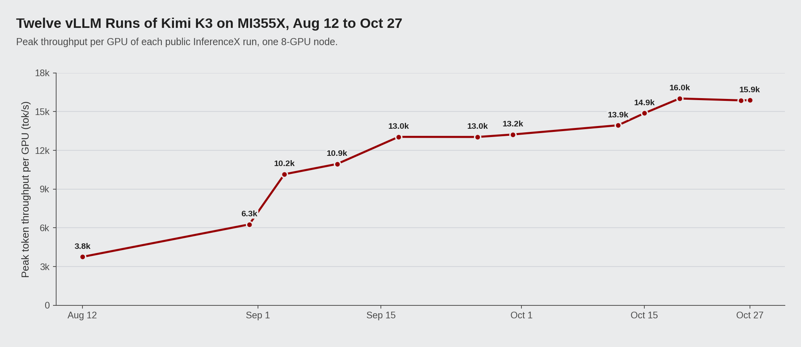

# 一台 MI355X 装下 2.8T 参数：vLLM 跑 Kimi-K3，每美元 token 产出最高达 B200 的 2.6 倍

*2026 年 11 月*

Kimi-K3 的 FP4 权重约 1.56 TB，八张 B200 或八张 GB200 都放不下。八张 AMD Instinct MI355X 合计有 2.3 TB 显存，一台节点就能跑起整个模型。在 SemiAnalysis 公开的 AgentX 基准上，这台跑 vLLM 的节点，在 B200、B300 和 GB200 NVL72 有同交互速度数据的地方，每美元 token 产出分别是它们的 1.9–2.6 倍、2.0–2.8 倍和 1.3–2.0 倍。它的峰值是每 1 美元 TCO 1970 万 token，在 Kimi-K3 dashboard 上最高。

8 月 12 日，MI355X 第一次跑这个模型，单卡吞吐峰值 3.8k tokens/s。十一周、十二次 vLLM 提交之后，10 月 27 日在同样的硬件上跑到了 15.9k。

下面先拿这台节点和 NVIDIA 的 Blackwell 系统做对比，再看这十一周里各次运行的变化，最后讲是哪些 kernel 和 vLLM 改动拉开了差距。

*图 1：Kimi-K3 FP4 在 AgentX 上「每 1 美元 TCO 总 token 数」随 P90 交互速度的变化，Rent – 3 年承诺价格，按 dashboard 的风格用 InferenceX 公开 API 数据绘制（获取于 2026-10-30）。NVIDIA 各系统取已公开框架里最好的一条；MI355X 是一台 8 卡节点，跑 vLLM。点外面有虚线圈，说明这个点开了 KV offload。*

## 基准和模型

SemiAnalysis 的 AgentX 基准在公开的 InferenceX CI 上运行，按轮次回放录下来的 agentic 编程会话，每一步都把越来越长的上下文重新发给模型。一个会话平均约 43 轮，一轮通常发出 142K token、拿回 444 token，每个 prompt 里超过 96% 的内容服务端之前已经见过。

Kimi-K3 有 2.8T 参数、896 个专家，原生上下文 1M token。一部分层用 Kimi Delta Attention（KDA），每个请求带一份循环状态；其余层用 MLA 和分页 KV cache。模型还附带一个 DSpark draft head（Inferact/Kimi-K3-DSpark）用于投机解码。这种组合对智能体流量不太友好：会话回来时，KV 页和 KDA 状态都得找回来，否则就要重算前缀，而 AgentX 上几乎每个请求都是回来的会话。

## 对比 NVIDIA Blackwell 各系统

每个系统只在几个并发点上测过，结果很少正好落在 40 tok/s/用户这样的整数上。表 1 按固定的交互速度读取各条曲线，取最近的两个实测点之间的值，方法和 dashboard 画线一样；某个系统在这一档两侧没有数据，就空着不填。

*表 1：固定 P90 交互速度下每 1 美元 TCO 的 token 数（百万，Rent 档位）。括号里是 MI355X 与该系统之比；「—」表示该系统在这一档附近没有数据。NVIDIA 各系统取已公开框架里最好的结果。*

| P90 交互速度 | MI355X | B200 | B300¹ | GB200 NVL72 | GB300 NVL72 |
|---|---|---|---|---|---|
| 25 tok/s/用户 | 19.1 | 9.9 (1.92×) | 7.1 (2.71×) | 9.8 (1.94×) | — |
| 40 tok/s/用户 | 16.5 | 7.7 (2.16×) | 5.8 (2.84×) | 8.4 (1.97×) | 18.9 (0.87×) |
| 60 tok/s/用户 | 10.9 | 4.9 (2.22×) | 4.6 (2.38×) | 7.1 (1.54×) | 17.2 (0.63×) |
| 80 tok/s/用户 | 8.4 | 3.4 (2.46×) | 3.8 (2.22×) | 6.6 (1.28×) | 12.1 (0.70×) |
| 100 tok/s/用户 | 6.7 | 2.6 (2.59×) | 3.4 (1.96×) | 5.2 (1.30×) | 9.1 (0.74×) |
| 峰值 | 19.7 | 10.4 (1.89×) | 10.6 (1.86×) | 9.9 (1.99×) | 19.1 (1.03×) |

¹ B300 最新公开的 Kimi-K3 结果是 2026-08-16 的，其余都是 10 月测的。

*图 2：把同样的对比换成比值，即 MI355X 每美元 token 数除以各 NVIDIA 系统的（Rent 档位）。柱子高过 1.0，说明 MI355X 每 token 更便宜。*

在表里的每一档，B200、B300 和 GB200 NVL72 都落后于 MI355X，差距分别是 1.9–2.6 倍、2.0–2.8 倍和 1.3–2.0 倍。和 B200 的差距主要来自吞吐，而不是价格：在这个范围内，一张 MI355X 干的活是一张 B200 的 1.5–2.0 倍，40 tok/s/用户时是 13.3k 对 7.9k tokens/s。和 GB200 比，在 25–40 tok/s/用户大约是 1.4 倍。换成 Owning 档位的价格，领先幅度略有收窄，对 B200 是 1.7–2.3 倍，对 GB200 是 1.2–1.8 倍。

GB300 NVL72 是例外。从 40 tok/s/用户往上，它的每美元 token 数更高，MI355X 只有它的 0.63–0.87 倍；GB300 这些点用的是 NVLink 机柜内 24 到 40 卡的宽 EP 分离式部署。在低交互速度那一端，MI355X 的峰值是 20.5 tok/s/用户时的 1970 万，略高于 GB300 的 1910 万。

## 十一周、十二次提交

8 月 12 日，vLLM 在 MI355X 上提交了第一份 Kimi-K3 AgentX，比 NVIDIA 的第一份结果晚两周，单卡峰值 3.8k tokens/s。到 10 月 27 日，峰值是 15.9k。中等交互速度下变化更大：40 tok/s/用户时，单卡吞吐从 2.1k 涨到 13.1k tokens/s；单用户速度从 61 升到 212 tok/s/用户。图 3 画了十二次运行中的四次，图 4 是每一次的峰值。这些运行都在公开的 InferenceX CI 上完成，每个服务实例用一台 8 卡 MI355X 节点。

*图 3：其中四次 vLLM 运行的单卡吞吐随 P90 交互速度的变化。标签是并行布局（TP8，或 TP8 加 8 路 decode 上下文并行）；有虚线圈的点用了 DRAM KV 层。*

*图 4：全部十二次 vLLM 运行的单卡吞吐峰值。*

峰值的提升大多发生在前期。头三周里，decode 上下文并行和 DRAM KV 层让并发 44–52 能实际跑起来，峰值从 3.8k 升到 10.2k。之后的运行对峰值影响不大，但一直在抬高曲线中段，40 tok/s/用户下每次最多再涨 19%。

## 为什么一台节点就够

*表 2：单卡显存、带宽、稠密 FP4 算力和 Rent – 3 年承诺价格。硬件数字取自 InferenceX GPU 规格页。*

| | MI355X | B200 | B300 | GB200 NVL72 | GB300 NVL72 |
|---|---|---|---|---|---|
| HBM 容量 | 288 GB HBM3E | 180 GB | 268 GB | 186 GB | 278 GB |
| HBM 带宽 | 8 TB/s | 8 TB/s | 8 TB/s | 8 TB/s | 8 TB/s |
| 稠密 FP4 算力 | 10.1 PFLOPS | 9.0 PFLOPS | 13.5 PFLOPS | 10.0 PFLOPS | 15.0 PFLOPS |
| Rent 价格（$/GPU/小时） | $2.90 | $3.70 | $4.25 | $4.00 | $5.00 |

起决定作用的是显存。TP8 下，Kimi-K3 1.56 TB 的 MXFP4 权重摊到每张 MI355X 上约 195 GB，一台节点里还有余量放 KV cache。八张 B200（1.44 TB）或八张 GB200（1.49 TB）连权重都放不下，所以两者已公开的配置都把模型拆到两台节点上，用流水线并行来跑，也就多了跨节点的通信开销。

算力差得不多。MI355X 的稠密 FP4 是 10.1 PFLOPS，B200 是 9.0，所以 40 tok/s/用户下 1.69 倍的单卡吞吐优势，主要是软件做出来的。下一节讲这些优势从哪来。

## 哪些改动起了作用

表 3 按实测效果给 vLLM 上的改动排了序。这些改动都在公开的 `vllm/vllm-openai-rocm` nightly 镜像里，也都接进了 [InferenceX 配方](https://github.com/SemiAnalysisAI/InferenceX)。

*表 3：MI355X 上 vLLM 改动按效果排序，吞吐为单卡。某个 tok/s/用户下的数值，从对应运行的曲线上读出。*

| 改动 | 涉及组件 | 效果 | 运行 |
|---|---|---|---|
| DCP8 和 DRAM KV 层 | vLLM、AITER | 40 tok/s/用户下 2.1k → 6.9k；峰值 3.8k → 10.2k | 8 月 31 日–9 月 4 日 |
| DSpark draft 改用 AITER MLA | vLLM、AITER | 并发 1 的 P90 交互速度 +28.9%，吞吐 +14.5% | 9 月 17 日 |
| 几乎所有点都用 DCP8，AITER ASM verify | vLLM、AITER | 20 tok/s/用户下 +26% | 10 月 12 日 |
| AITER Gluon KDA kernel、低延迟 MoE router GEMM | vLLM、AITER | 40 tok/s/用户下 +19%；峰值 14.9k → 16.0k | 10 月 19 日 |
| 并发 1 使用常驻 FlyDSL decode kernel | vLLM、FlyDSL | 单用户速度 178 → 211 tok/s/用户 | 10 月 26 日 |
| FP8 融合、latent-MoE 只存本 rank 分片 | vLLM | 30 tok/s/用户下 +17%；峰值 13.9k → 14.9k | 10 月 15 日 |
| 兼顾尾部延迟的准入上限 | vLLM | 40 tok/s/用户下 +15%，60 tok/s/用户下 +17% | 10 月 27 日 |

### decode 上下文并行和 DRAM KV 层

智能体每一轮的上下文远超 100K token，这么长的时候 decode 大部分时间都在读 KV。decode 上下文并行把 KV 读取分给全部八张卡，各卡的部分结果用 all-to-all 合并，投机解码的多 token verify 步骤跑在 AITER ASM kernel 上。HBM 里放不下的 KV 页，通过 SimpleCPUOffloadConnector 放到每 rank 约 225 GB 的 DRAM 层。两者都就位之后，并发 60 以内都能在一台节点上跑。后来把 DCP8 用到几乎所有并发，20 tok/s/用户下的吞吐又提升了 26%。

### 投机解码

vLLM 用 DSpark head 生成草稿，草稿长度按并发定：并发 1 用 7 个 token，批次变大后降到 5、再到 4。这里单项收益最大的是 draft 自己的注意力：从 Triton MLA 换成 AITER MLA（[vllm#55966](https://github.com/vllm-project/vllm/pull/55966)）后，并发 1 的 P90 交互速度提升 28.9%，吞吐提升 14.5%。

### AITER 和 FlyDSL kernel

896 个专家跑在 AITER 的 MXFP4 MoE kernel（SITUV2，A8W4）上，配合 FlyDSL stage-2 FP8。周边一些小改动也加起来不少：支持任意输入 shape 的低延迟 MoE router GEMM（[vllm#61895](https://github.com/vllm-project/vllm/pull/61895)）、预 shuffle 的 FP4 GEMM 配置，以及只存本 rank 分片的 latent-MoE up-projection（[vllm#59591](https://github.com/vllm-project/vllm/pull/59591)）。KDA 用上了 AITER Gluon kernel，覆盖 decode 和投机解码（[vllm#57392](https://github.com/vllm-project/vllm/pull/57392)）以及分块 prefill（[vllm#59552](https://github.com/vllm-project/vllm/pull/59552)）。带来 Gluon KDA decode kernel 和 router GEMM 的那个镜像，让 40 tok/s/用户下的吞吐提升了 19%。更早的一个镜像加入了 FP8 融合（比如 AttnRes 输出与逐 token FP8 量化融合，[vllm#59069](https://github.com/vllm-project/vllm/pull/59069)）和上面的 latent-MoE 改动，30 tok/s/用户下提升了 17%。

单用户的一个 decode step 是一串小 kernel 加集合通信，主要开销在 launch 和同步上。现在并发 1 时，vLLM 把每个 MoE decoder 层跑成一个常驻的 FlyDSL kernel，TP all-reduce 在 kernel 内完成（[vllm#60683](https://github.com/vllm-project/vllm/pull/60683)），单用户速度从 178 升到 211 tok/s/用户。

### 准入控制

在一次运行里，最慢的 10% decode step 全落在最大的那些批次上。把并发 4–32 的运行序列数上限压到这个规模以下之后，40 tok/s/用户下吞吐提升 15%，60 tok/s/用户下提升 17%。

## 致谢

感谢 Moonshot AI 和 vLLM 社区，感谢 Inferact 提供 DSpark draft 模型，感谢 SemiAnalysis 运行 AgentX 和 InferenceX CI，也感谢 AMD AITER、FlyDSL、vLLM 和 ROCm 团队。

## 参考资料

1. SemiAnalysis InferenceX，Kimi-K3 dashboard。https://inferencex.semianalysis.com/inference/kimi-k3
2. SemiAnalysis AI Cloud TCO Model，$/GPU/hr 价格来源。https://semianalysis.com/ai-cloud-tco-model/
3. AMD，*MoRI UMBP Empowers AMD Instinct™ MI355X GPU to Demonstrate Token-per-Dollar TCO Leadership on the Public AgentX Leaderboard*，AgentX 的更多介绍。https://www.amd.com/en/developer/resources/technical-articles/2026/mori-umbp-empowers-amd-instinct-gpus.html
4. MI355X 上 Kimi-K3 vLLM 配方的 InferenceX 演进：PR [#2508](https://github.com/SemiAnalysisAI/InferenceX/pull/2508)、[#2787](https://github.com/SemiAnalysisAI/InferenceX/pull/2787)、[#2810](https://github.com/SemiAnalysisAI/InferenceX/pull/2810)、[#3124](https://github.com/SemiAnalysisAI/InferenceX/pull/3124)、[#3833](https://github.com/SemiAnalysisAI/InferenceX/pull/3833)、[#3951](https://github.com/SemiAnalysisAI/InferenceX/pull/3951)、[#4215](https://github.com/SemiAnalysisAI/InferenceX/pull/4215)、[#4393](https://github.com/SemiAnalysisAI/InferenceX/pull/4393)、[#4473](https://github.com/SemiAnalysisAI/InferenceX/pull/4473)。
