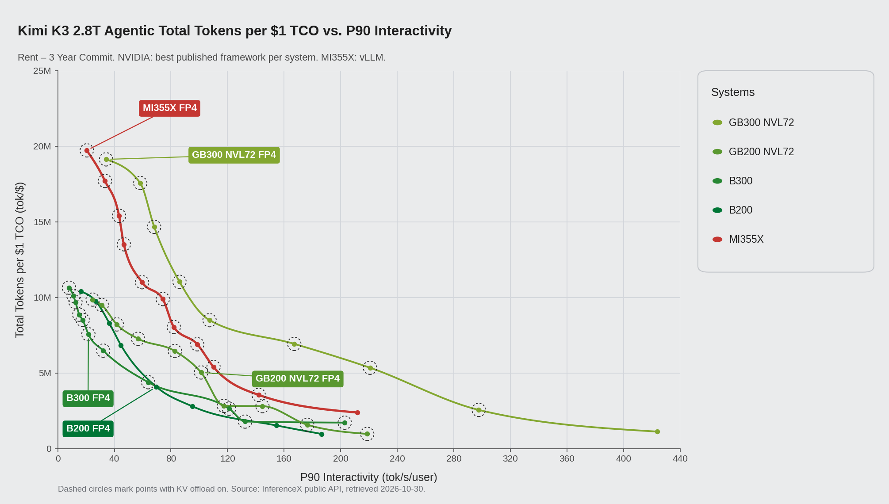
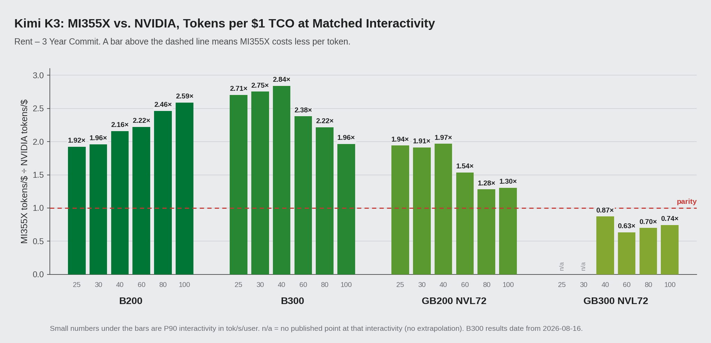
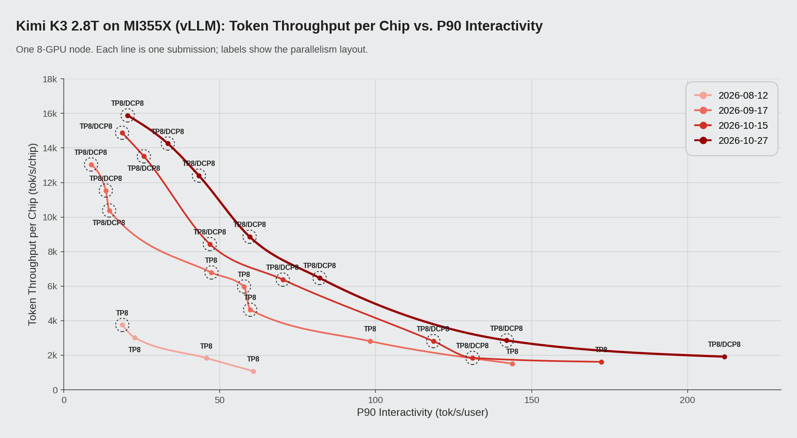
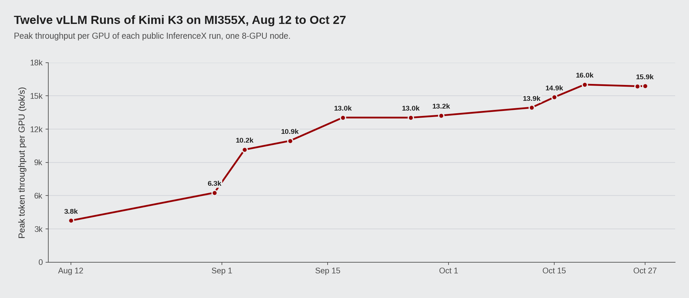

# One MI355X Node for All 2.8T Parameters: Kimi-K3 on vLLM at Up to 2.6× the Tokens per Dollar of B200

*November 2026*

Kimi-K3's FP4 weights take about 1.56 TB, more than eight B200s or eight GB200s can hold. Eight AMD Instinct MI355X GPUs have 2.3 TB between them, so the model runs on a single node. On SemiAnalysis's public AgentX benchmark, that node, running vLLM, now produces 1.9–2.6× the tokens per dollar of B200, 2.0–2.8× of B300 and 1.3–2.0× of GB200 NVL72 wherever they have results at the same interactivity. Its peak, 19.7M tokens per $1 TCO, is the highest on the Kimi-K3 dashboard.

The first MI355X run of the model, on Aug 12, peaked at 3.8k tokens/s per GPU. Eleven weeks and twelve vLLM submissions later, on Oct 27, it reached 15.9k on the same hardware.

Below we compare the node with NVIDIA's Blackwell systems, follow the runs over those eleven weeks, and go through the kernel and vLLM changes that made the difference.

*Figure 1: Total tokens per $1 TCO against P90 interactivity for Kimi-K3 FP4 on AgentX, Rent – 3-year commit pricing, drawn in the dashboard's style from the InferenceX public API (retrieved 2026-10-30). NVIDIA curves use each system's best published framework; MI355X is one 8-GPU node with vLLM. A dashed ring means KV offload was on for that point.*

## The benchmark and the model

SemiAnalysis's AgentX benchmark runs in the public InferenceX CI and replays recorded agentic coding sessions turn by turn, sending the growing context back to the model at each step. Sessions average about 43 turns. A typical turn sends 142K tokens and gets 444 back, and the server has already seen more than 96% of each prompt.

Kimi-K3 has 2.8T parameters across 896 experts and a native context of 1M tokens. Some of its layers use Kimi Delta Attention (KDA), which carries a recurrent state per request; the rest use MLA with a paged KV cache. A DSpark draft head (Inferact/Kimi-K3-DSpark) comes with it for speculative decoding. For agent traffic the mix is awkward. A returning session needs both its KV pages and its KDA state back, or the prefix gets recomputed, and on AgentX nearly every request is a returning session.

## Against NVIDIA's Blackwell systems

Every system was benchmarked at a few concurrency settings, so few results sit exactly on a round number like 40 tok/s/user. For Table 1 we read each curve at fixed levels, interpolating between the two closest measurements as the dashboard does, and leave a cell blank where a system has no data on both sides.

*Table 1: Tokens per $1 TCO in millions at fixed P90 interactivity, Rent tier. The ratio in brackets is MI355X over that system; "—" marks a level the system has no data around. NVIDIA systems use their best published framework.*

| P90 interactivity | MI355X | B200 | B300¹ | GB200 NVL72 | GB300 NVL72 |
|---|---|---|---|---|---|
| 25 tok/s/user | 19.1 | 9.9 (1.92×) | 7.1 (2.71×) | 9.8 (1.94×) | — |
| 40 tok/s/user | 16.5 | 7.7 (2.16×) | 5.8 (2.84×) | 8.4 (1.97×) | 18.9 (0.87×) |
| 60 tok/s/user | 10.9 | 4.9 (2.22×) | 4.6 (2.38×) | 7.1 (1.54×) | 17.2 (0.63×) |
| 80 tok/s/user | 8.4 | 3.4 (2.46×) | 3.8 (2.22×) | 6.6 (1.28×) | 12.1 (0.70×) |
| 100 tok/s/user | 6.7 | 2.6 (2.59×) | 3.4 (1.96×) | 5.2 (1.30×) | 9.1 (0.74×) |
| Peak | 19.7 | 10.4 (1.89×) | 10.6 (1.86×) | 9.9 (1.99×) | 19.1 (1.03×) |

¹ B300's latest published Kimi-K3 results are from 2026-08-16; everything else was measured in October.

*Figure 2: The same comparison as a ratio, MI355X tokens per dollar over each NVIDIA system's, Rent tier. Bars above 1.0 mean a lower cost per token on MI355X.*

B200, B300 and GB200 NVL72 trail MI355X at every level in the table, by 1.9–2.6×, 2.0–2.8× and 1.3–2.0×. Against B200 the gap is mainly throughput, not price: one MI355X GPU does 1.5–2.0× the work of one B200 over this range, 13.3k against 7.9k tokens/s at 40 tok/s/user. Against GB200 it does about 1.4× the work at 25–40 tok/s/user. Owning-tier prices narrow the lead a little, to 1.7–2.3× over B200 and 1.2–1.8× over GB200.

GB300 NVL72 is the exception. From 40 tok/s/user up it gets more tokens per dollar, with MI355X at 0.63–0.87× of it, using disaggregated wide-EP setups of 24 to 40 GPUs within the NVLink rack. At the low-interactivity end the MI355X peak, 19.7M at 20.5 tok/s/user, edges past GB300's 19.1M.

## Twelve runs in eleven weeks

The first vLLM run of Kimi-K3 AgentX on MI355X went in on Aug 12, two weeks after the first NVIDIA result, and peaked at 3.8k tokens/s per GPU. By Oct 27 the peak was 15.9k. The gain is bigger at moderate interactivity: at 40 tok/s/user, throughput went from 2.1k to 13.1k tokens/s per GPU, and single-user speed went from 61 to 212 tok/s/user. Figure 3 shows four of the twelve runs and Figure 4 shows the peak of every one. All of them ran in the public InferenceX CI, with one 8-GPU MI355X node per server.

*Figure 3: Throughput per GPU against P90 interactivity for four of the vLLM runs. Labels give the parallelism layout (TP8, or TP8 with 8-way decode context parallelism); a dashed ring means the point used the DRAM KV tier.*

*Figure 4: Peak throughput per GPU of all twelve vLLM runs.*

Most of the peak gain came early. Within three weeks, decode context parallelism and a DRAM KV tier made concurrency 44–52 practical and took the peak from 3.8k to 10.2k. Later runs moved the peak less but kept lifting the middle of the curve, by up to 19% per run at 40 tok/s/user.

## Why one node is enough

*Table 2: Memory, bandwidth, dense FP4 compute and Rent – 3-year commit price per GPU. Hardware figures are from the InferenceX GPU specs page.*

| | MI355X | B200 | B300 | GB200 NVL72 | GB300 NVL72 |
|---|---|---|---|---|---|
| HBM capacity | 288 GB HBM3E | 180 GB | 268 GB | 186 GB | 278 GB |
| HBM bandwidth | 8 TB/s | 8 TB/s | 8 TB/s | 8 TB/s | 8 TB/s |
| Dense FP4 | 10.1 PFLOPS | 9.0 PFLOPS | 13.5 PFLOPS | 10.0 PFLOPS | 15.0 PFLOPS |
| Rent, $/GPU-hour | $2.90 | $3.70 | $4.25 | $4.00 | $5.00 |

The deciding number is memory. At TP8, Kimi-K3's 1.56 TB of MXFP4 weights come to about 195 GB per MI355X, which leaves headroom for KV cache within one node. Eight B200s (1.44 TB) or eight GB200s (1.49 TB) cannot hold the weights at all, so the published configurations for both spread the model over two nodes with pipeline parallelism and take on the cross-node traffic that comes with it.

Compute is closer. MI355X has 10.1 PFLOPS of dense FP4 against B200's 9.0, so its 1.69× per-GPU lead at 40 tok/s/user is mostly a software result. The next section covers where it came from.

## What moved the numbers

Table 3 ranks the vLLM changes by measured effect. All of them ship in the public `vllm/vllm-openai-rocm` nightly images and are wired up in the [InferenceX recipes](https://github.com/SemiAnalysisAI/InferenceX).

*Table 3: vLLM changes on MI355X ranked by effect, throughput per GPU. Values at a given tok/s/user are read off each run's curve.*

| Change | Components | Effect | Run |
|---|---|---|---|
| DCP8 and a DRAM KV tier | vLLM, AITER | At 40 tok/s/user 2.1k → 6.9k; peak 3.8k → 10.2k | Aug 31–Sep 4 |
| AITER MLA for the DSpark draft | vLLM, AITER | +28.9% P90 interactivity and +14.5% throughput at concurrency 1 | Sep 17 |
| DCP8 at nearly every point, AITER ASM verify | vLLM, AITER | +26% at 20 tok/s/user | Oct 12 |
| AITER Gluon KDA kernels, low-latency MoE router GEMM | vLLM, AITER | +19% at 40 tok/s/user; peak 14.9k → 16.0k | Oct 19 |
| Persistent FlyDSL decode kernels at concurrency 1 | vLLM, FlyDSL | Single-user speed 178 → 211 tok/s/user | Oct 26 |
| FP8 fusions, latent-MoE local shards | vLLM | +17% at 30 tok/s/user; peak 13.9k → 14.9k | Oct 15 |
| Tail-aware admission caps | vLLM | +15% at 40 tok/s/user, +17% at 60 tok/s/user | Oct 27 |

### Decode context parallelism and the DRAM KV tier

Agent turns carry contexts well past 100K tokens, and at that length decode spends most of its time reading KV. With decode context parallelism the KV read is split over all eight GPUs, partial results are combined with an all-to-all, and the multi-token verify step for speculative decoding runs on an AITER ASM kernel. KV pages that no longer fit in HBM go to a DRAM tier of about 225 GB per rank through SimpleCPUOffloadConnector. With both in place, concurrency up to 60 fits on one node. Applying DCP8 to nearly every concurrency later raised throughput at 20 tok/s/user by another 26%.

### Speculative decoding

vLLM drafts with the DSpark head and sets the draft length by concurrency: 7 tokens at concurrency 1, then 5, then 4 as batches grow. The largest single gain here came from the draft's own attention. Switching it from Triton MLA to AITER MLA ([vllm#55966](https://github.com/vllm-project/vllm/pull/55966)) raised P90 interactivity by 28.9% and throughput by 14.5% at concurrency 1.

### AITER and FlyDSL kernels

The 896 experts run on AITER MXFP4 MoE kernels (SITUV2, A8W4) with FlyDSL stage-2 FP8. Smaller pieces around them added up: a low-latency MoE router GEMM for any input shape ([vllm#61895](https://github.com/vllm-project/vllm/pull/61895)), preshuffled FP4 GEMM configurations, and latent-MoE up-projections that store only the local rank's shards ([vllm#59591](https://github.com/vllm-project/vllm/pull/59591)). KDA got AITER Gluon kernels for decode and speculative decode ([vllm#57392](https://github.com/vllm-project/vllm/pull/57392)) and for chunked prefill ([vllm#59552](https://github.com/vllm-project/vllm/pull/59552)). The image with the Gluon KDA decode kernels and the router GEMM raised throughput at 40 tok/s/user by 19%. An earlier one, with FP8 fusions such as AttnRes output plus per-token FP8 quantization ([vllm#59069](https://github.com/vllm-project/vllm/pull/59069)) and the latent-MoE change, added 17% at 30 tok/s/user.

A single-user decode step is a chain of small kernels and collectives, so launch and synchronization overhead dominate it. At concurrency 1, vLLM now runs each MoE decoder layer as one persistent FlyDSL kernel with the TP all-reduce done inside it ([vllm#60683](https://github.com/vllm-project/vllm/pull/60683)). That took single-user speed from 178 to 211 tok/s/user.

### Admission control

In one run the slowest 10% of decode steps all fell in the largest batches. Capping running sequences at concurrency 4–32 below that size raised throughput by 15% at 40 tok/s/user and 17% at 60 tok/s/user.

## Acknowledgements

We thank Moonshot AI and the vLLM community, Inferact for the DSpark draft model, SemiAnalysis for running AgentX and the InferenceX CI, and the AMD AITER, FlyDSL, vLLM and ROCm teams.

## References

1. SemiAnalysis InferenceX, Kimi-K3 dashboard. https://inferencex.semianalysis.com/inference/kimi-k3
2. SemiAnalysis AI Cloud TCO Model, for the $/GPU/hr rates. https://semianalysis.com/ai-cloud-tco-model/
3. AMD, *MoRI UMBP Empowers AMD Instinct™ MI355X GPU to Demonstrate Token-per-Dollar TCO Leadership on the Public AgentX Leaderboard*, for more on AgentX. https://www.amd.com/en/developer/resources/technical-articles/2026/mori-umbp-empowers-amd-instinct-gpus.html
4. InferenceX recipe history for MI355X Kimi-K3 on vLLM: PRs [#2508](https://github.com/SemiAnalysisAI/InferenceX/pull/2508), [#2787](https://github.com/SemiAnalysisAI/InferenceX/pull/2787), [#2810](https://github.com/SemiAnalysisAI/InferenceX/pull/2810), [#3124](https://github.com/SemiAnalysisAI/InferenceX/pull/3124), [#3833](https://github.com/SemiAnalysisAI/InferenceX/pull/3833), [#3951](https://github.com/SemiAnalysisAI/InferenceX/pull/3951), [#4215](https://github.com/SemiAnalysisAI/InferenceX/pull/4215), [#4393](https://github.com/SemiAnalysisAI/InferenceX/pull/4393), [#4473](https://github.com/SemiAnalysisAI/InferenceX/pull/4473).
